# 编译期字节码插桩与监控自动化

字节码插桩（bytecode instrumentation）是在源码编译成 JVM `.class` 之后、生成 DEX 之前自动检查或改写指令。它适合处理“规则明确、调用点很多、人工埋点容易遗漏”的任务，例如给一组业务入口加 trace（按时间记录代码区间的跟踪片段）、把已有 API 调用改写到监控桥接层，或检查某类调用是否符合约束。

插桩只能改写进入当前 App 构建流程的 class，无法自动推导性能问题的因果关系，也不适合修改 Android framework（随系统镜像发布的 Java/Kotlin 框架代码）、ART（`Android Runtime`，负责执行 DEX 并管理应用运行）或任意第三方库的内部实现。

平台语义以 Android 17 / API 37 / `android-17.0.0_r1` 为准。

AGP（Android Gradle Plugin）是把 Android 模块接入 Gradle 构建流程的插件。本文固定AGP9.3.3的Instrumentation API基线，以覆盖本页使用的POST_COMPILATION_CLASSES。2026年10月25日metadata中最新无预览后缀的稳定版是9.4.1，release标签则可能指向9.6.0-alpha01，不能据该标签选择生产稳定版。本文9.3系列支持最高API37，要求Gradle9.5.0和JDK17；升级版本应另核兼容表。

Android 17 没有改变 App 构建期 `.class` 插桩的基本边界。运行时证据仍来自公开 Trace API、Perfetto（系统级跟踪的采集与分析工具）、JankStats、网络库接口和业务指标。

## 先确定插桩边界

一套可维护的插桩监控方案分为四层：选择规则、字节码变换、运行时桥接、验证与发布。四层各自负责一段职责，也各有典型的出错方式。

| 层级 | 责任 | 常见错误 |
|---|---|---|
| 选择规则 | 决定哪些 variant、class、method 需要处理 | Release 无条件全量插桩，或误改生成代码与依赖 |
| 字节码变换 | 保证控制流、操作数栈、局部变量和 frame 合法 | 只处理正常 `return`，异常路径没有清理 |
| 运行时桥接 | 采样、限流、隐私处理并写入 Trace/APM | 在热路径分配对象、同步 I/O 或递归调用 |
| 验证与发布 | 校验 class、D8/R8 产物、运行时 trace 和成本 | 只看编译成功，没有检查优化后产物 |

variant 是由构建类型、产品风味等配置组合出的构建变体。stack frame 是 JVM verifier（字节码验证器）用来核对操作数栈和局部变量类型的校验信息。

APM（Application Performance Monitoring）指应用性能监控。热路径是调用频繁的代码路径，少量额外工作也可能累积成明显开销。

“无业务手写埋点”仍会带来侵入：每条注入指令都会改变 class、构建时间和运行路径。是否启用、覆盖哪些方法以及容许多少成本，都应由当前工程的测量结果决定。

<!-- gracker-diagram: a297-01-class-to-release-evidence-pipeline -->
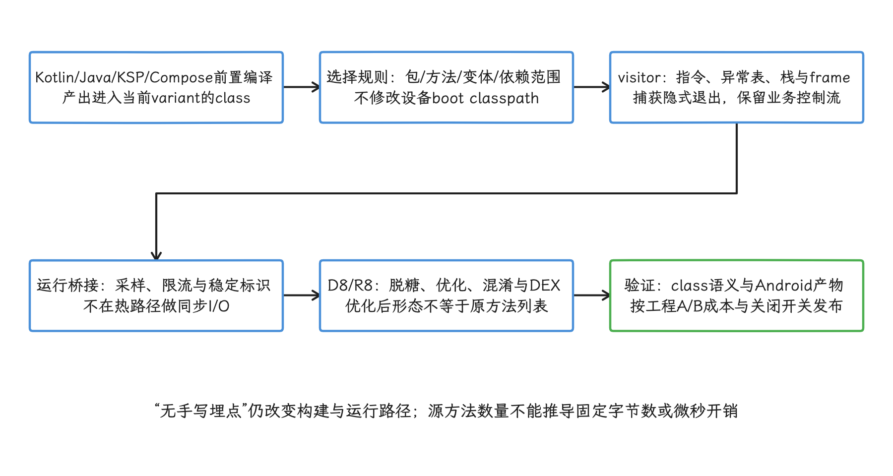

图：App与选定依赖class可处理；framework、ART与未进入构建输入的代码不在覆盖内。

## ASM Core API 与 Tree API

ASM 是一个直接读写 JVM class 的字节码库。Core API 采用 visitor（访问器）回调：`ClassVisitor` 接收类级结构，`MethodVisitor` 依次接收方法指令。它适合局部、流式的变换，通常无需把整个类的表示保存在内存中。

Tree API 把类读入 `ClassNode`，并把方法指令保存在 `InsnList`。需要多次遍历同一方法、重排较长指令序列或分析控制流时，Tree API 更容易编写，代价是更多内存和对象分配。

选择依据来自变换本身：

- 入口、出口、调用点替换等局部操作优先使用 Core API。
- 需要查看一个方法的完整指令、异常表和跳转关系时考虑 Tree API。
- 需要全程序调用图、跨类数据流或统一改写 jar 时，逐 class 的 Instrumentation API 信息不足，应通过 AGP Scoped Artifacts（按当前模块或连同依赖取得整组构建产物的 API）注册独立 task。

### ASM 在构建流程中的位置

ASM 的输入是 JVM class；DEX 在后续阶段产生。Kotlin 编译器、KSP（Kotlin Symbol Processing，在编译期间读取程序符号并生成代码）、Compose Compiler 等前置步骤先生成 class，AGP 插桩随后处理。

D8/R8 再执行 desugar（把较新的 Java 字节码特性转换成旧 Android 版本可执行的形式）、压缩、优化、混淆和 DEX 转换。R8 是 Android 的代码压缩与优化器，D8 则负责把 JVM 字节码转换为 DEX。

<!-- gracker-diagram: a297-02-core-tree-and-scoped-artifacts -->
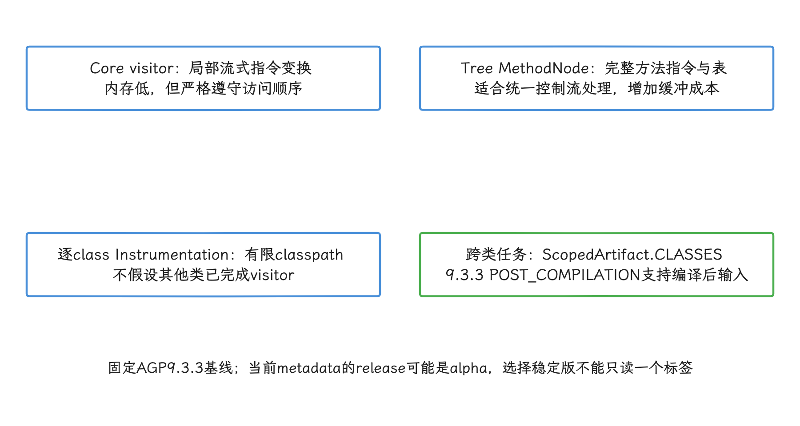

图：新增class先读POST_COMPILATION_CLASSES再append到CLASSES，避免同时消费和生成同一产物形成环。

## AGP 9.3.3 的插桩入口

Instrumentation API 是 AGP 为逐 class 注册 ASM visitor 的公开接口。它支持增量处理，也允许 AGP 并行准备不同依赖。visitor 只能看到有限的 classpath（编译当前 class 时可查询的类集合），不能假设所有 class 已完成其他 visitor 的变换。

### Transform API 已被移除

旧的 `com.android.build.api.transform.Transform` 在 AGP 7.2 被废弃，并从 AGP 8.0 移除。官方的 [AGP API 更新说明](https://developer.android.com/build/releases/gradle-plugin-api-updates)没有提供一个覆盖所有旧用法的单一替代物，迁移入口取决于任务目标：

- 独立处理每个 class：使用 `variant.instrumentation.transformClassesWith()`。
- 读取或变换整组 class：使用 `variant.artifacts.forScope()` 和 [`ScopedArtifact.CLASSES`](https://developer.android.com/reference/tools/gradle-api/9.3/com/android/build/api/artifact/ScopedArtifact.CLASSES)。
- 在编译后生成新 class 且还要读取已编译 class：读取 `ScopedArtifact.POST_COMPILATION_CLASSES`，再把生成目录追加到 `ScopedArtifact.CLASSES`，避免任务同时消费和生成同一个产物形成循环依赖。`POST_COMPILATION_CLASSES`在9.3.3才加入且标有 `@Incubating`，使用它的插件应固定 AGP 版本并保留升级集成测试。

### 注册 AsmClassVisitorFactory

下面的 Kotlin 代码把 factory（为每个 class 创建 visitor 的工厂）注册到 release variant，并让 AGP 为被修改的方法重新计算 stack frame。示例使用 `PROJECT`，只处理当前 Android 模块的 class。

```kotlin
import com.android.build.api.instrumentation.FramesComputationMode
import com.android.build.api.instrumentation.InstrumentationScope
import com.android.build.api.variant.ApplicationAndroidComponentsExtension
import org.gradle.api.Plugin
import org.gradle.api.Project
import org.gradle.kotlin.dsl.getByType

class TraceInstrumentationPlugin : Plugin<Project> {
    override fun apply(project: Project) {
        project.pluginManager.withPlugin("com.android.application") {
            val androidComponents =
                project.extensions.getByType<ApplicationAndroidComponentsExtension>()

            androidComponents.onVariants(
                androidComponents.selector().withBuildType("release")
            ) { variant ->
                variant.instrumentation.transformClassesWith(
                    TraceClassVisitorFactory::class.java,
                    InstrumentationScope.PROJECT
                ) { params ->
                    params.packagePrefixes.set(listOf("com.example.app"))
                }

                variant.instrumentation.setAsmFramesComputationMode(
                    FramesComputationMode.COMPUTE_FRAMES_FOR_INSTRUMENTED_METHODS
                )
            }
        }
    }
}
```

这段代码只展示注册关系。工程应把包前缀和启用 variant 暴露为插件扩展，避免把示例值复制到多个模块。

`InstrumentationScope` 决定 visitor 处理哪些 class。应用和测试模块可选择 `PROJECT` 或 `ALL`；Android library 只能对本项目 class 注册 Instrumentation。`ALL` 会处理传递依赖，可能重复修改已插桩库，也会把第三方版本差异纳入兼容范围，因此不宜作为默认值。

`COMPUTE_FRAMES_FOR_INSTRUMENTED_METHODS` 适合给既有方法增加控制流。如果 visitor 只加注解或能够自行维护 frame，`COPY_FRAMES` 的构建成本更低。

`COMPUTE_FRAMES_FOR_ALL_CLASSES` 会触发非增量的全类计算，只有改变继承关系等特殊变换才应考虑。

<!-- gracker-diagram: a297-03-scope-and-frame-recomputation -->
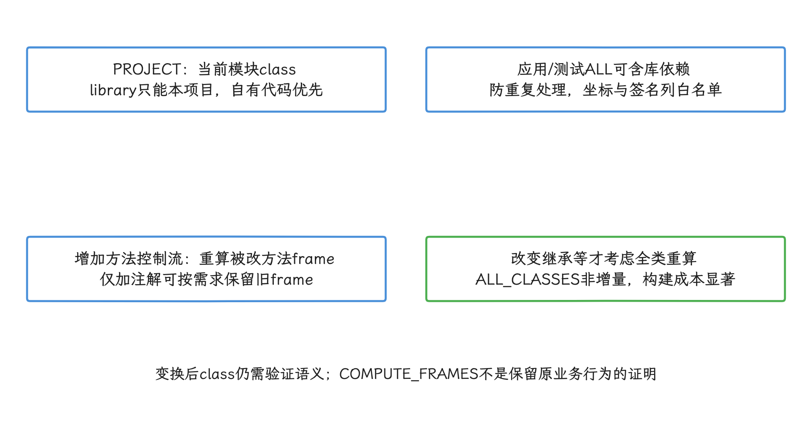

图：Transform API已移除；逐类、跨类和编译后生成class有不同迁移入口。

### Factory 必须支持异步调用

AGP 的 [`AsmClassVisitorFactory`](https://developer.android.com/reference/tools/gradle-api/8.6/com/android/build/api/instrumentation/AsmClassVisitorFactory) 8.6 版本页保留了异步调用约束，当前 AGP 9.3 API 也有相同要求：`isInstrumentable()` 和 `createClassVisitor()` 可能异步调用。

不同 class 的回调可能并发发生。factory 不应使用可变全局集合统计访问结果，也不应在回调中读写共享文件。

下面的代码用于声明可缓存的输入参数、过滤生成类，并把 AGP 提供的 ASM API 版本交给 visitor。

```kotlin
import com.android.build.api.instrumentation.AsmClassVisitorFactory
import com.android.build.api.instrumentation.ClassContext
import com.android.build.api.instrumentation.ClassData
import com.android.build.api.instrumentation.InstrumentationParameters
import org.gradle.api.provider.ListProperty
import org.gradle.api.tasks.Input
import org.objectweb.asm.ClassVisitor

interface TraceParameters : InstrumentationParameters {
    @get:Input
    val packagePrefixes: ListProperty<String>
}

abstract class TraceClassVisitorFactory :
    AsmClassVisitorFactory<TraceParameters> {

    override fun isInstrumentable(classData: ClassData): Boolean {
        val className = classData.className
        val simpleName = className.substringAfterLast('.')
        val inConfiguredPackage = parameters.get().packagePrefixes.get()
            .any { prefix ->
                className == prefix || className.startsWith("$prefix.")
            }

        return inConfiguredPackage &&
            simpleName != "R" &&
            !simpleName.startsWith("R\$") &&
            simpleName != "BuildConfig"
    }

    override fun createClassVisitor(
        classContext: ClassContext,
        nextClassVisitor: ClassVisitor
    ): ClassVisitor {
        return TraceClassVisitor(
            api = instrumentationContext.apiVersion.get(),
            next = nextClassVisitor
        )
    }
}
```

截至2026年10月25日，上游ASM最新版本为9.11.1（10月17日发布），但插件不应把这个数字直接写进 visitor。代码使用 `instrumentationContext.apiVersion`，是为了服从 AGP 实际内置的 ASM API 版本，避免插件声明的版本高于构建环境。

`ClassData.className` 使用点分隔的全限定类名。过滤逻辑需要覆盖 `R` 的内部类，并按工程情况排除生成代码、Data Binding、Hilt、Compose synthetic（编译器合成的方法或类）以及监控 SDK 自身。

参数必须通过 Gradle `Property`、`ListProperty`、`RegularFileProperty` 等声明输入。回调中临时读取未声明的 YAML 或 JSON，会让 Gradle 无法正确判断任务是否已是最新状态，也会破坏 `build cache`（跨构建复用任务输出的缓存）命中。

<!-- gracker-diagram: a297-04-factory-parallelism-and-gradle-inputs -->
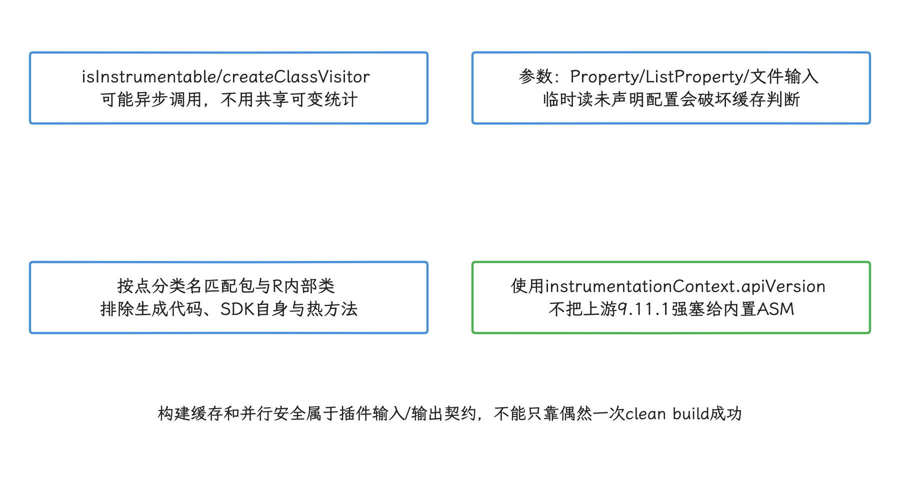

图：逐类visitor不写共享文件；全局映射与冲突检查放独立可缓存任务。

## 方法 trace 的控制流必须完整

### 为什么只检查 RETURN 和 ATHROW 不够

`RETURN` 和 `ATHROW` 是 JVM 表示“返回”和“抛出异常”的 opcode（操作码）。只在这些操作码前插入 `Trace.endSection()`，只能覆盖显式出现在当前方法字节码中的退出指令。

例如，`repository.load()` 抛出的异常可以直接沿调用栈传播。即使当前方法没有自己的 `ATHROW`，它仍可能在调用指令 `INVOKEVIRTUAL` 处退出。visitor 若只观察退出 opcode，`Trace.beginSection()` 就无法配对，后续同线程的嵌套 section 也会错位。

稳妥做法是给原方法体增加 catch-all handler（捕获所有传播到方法边界的 `Throwable` 的异常处理块），语义等价于 `try/finally`：正常返回前调用 `endSection()`；异常路径由 handler 调用 `endSection()` 后原样抛出。

构造器涉及未初始化this及this()/super()构造链，不能照搬普通方法入口。AdviceAdapter能协助处理入口位置，但捕获所有异常时还必须保留原异常表优先级并遵守visitTryCatchBlock先于相关label的访问契约。

下面采用逐方法MethodNode缓冲：先读取完整指令与原异常表，把catch-all追加为最后一项，再由MethodNode按合法顺序输出。这样同时保留原catch/finally优先级和label访问约束，代价是该方法树的内存。示例跳过abstract、native、synthetic和构造器，加入不可见版本标记，使同规则二次处理不重复注入。

<!-- gracker-diagram: a297-05-normal-return-and-propagating-exception -->
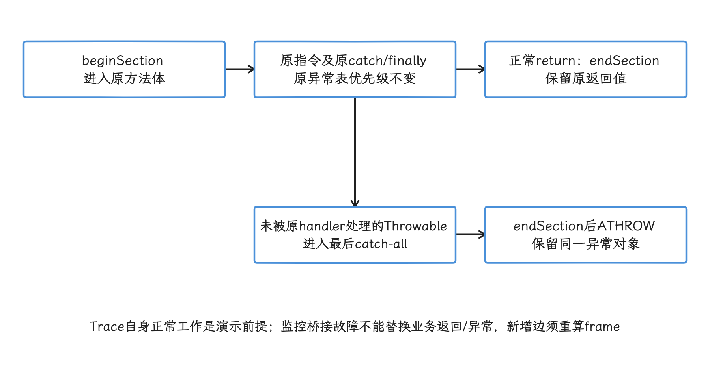

图：方法树输出会先发异常表再发相关label；只处理RETURN/ATHROW不能覆盖调用点隐式异常退出。

```kotlin
import org.objectweb.asm.ClassVisitor
import org.objectweb.asm.MethodVisitor
import org.objectweb.asm.Opcodes
import org.objectweb.asm.tree.AnnotationNode
import org.objectweb.asm.tree.InsnList
import org.objectweb.asm.tree.InsnNode
import org.objectweb.asm.tree.LabelNode
import org.objectweb.asm.tree.LdcInsnNode
import org.objectweb.asm.tree.MethodInsnNode
import org.objectweb.asm.tree.MethodNode
import org.objectweb.asm.tree.TryCatchBlockNode
import java.nio.charset.StandardCharsets
import java.security.MessageDigest

class TraceClassVisitor(api: Int, next: ClassVisitor) : ClassVisitor(api, next) {
    private var ownerInternalName = ""

    override fun visit(
        version: Int,
        access: Int,
        name: String,
        signature: String?,
        superName: String?,
        interfaces: Array<out String>?
    ) {
        ownerInternalName = name
        super.visit(version, access, name, signature, superName, interfaces)
    }

    override fun visitMethod(
        access: Int,
        name: String,
        descriptor: String,
        signature: String?,
        exceptions: Array<out String>?
    ): MethodVisitor? {
        val next = super.visitMethod(access, name, descriptor, signature, exceptions)
            ?: return null
        val excluded = access and (
            Opcodes.ACC_ABSTRACT or Opcodes.ACC_NATIVE or Opcodes.ACC_SYNTHETIC
        ) != 0
        if (excluded || name == "<init>" || name == "<clinit>") return next

        val traceTag = buildTraceTag(ownerInternalName, name, descriptor)
        // Buffer one method so existing exception handlers keep their priority.
        return object : MethodNode(api, access, name, descriptor, signature, exceptions) {
            override fun visitEnd() {
                super.visitEnd()
                val marked = invisibleAnnotations.orEmpty().any {
                    it.desc == MARKER_DESCRIPTOR
                }
                if (!marked) instrumentMethod(this, traceTag)
                // MethodNode emits the full exception table before its labels.
                accept(next)
            }
        }
    }

    companion object {
        private const val MARKER_DESCRIPTOR =
            "Lcom/example/monitor/TraceInstrumentedV1;"
        private const val TRACE_OWNER = "android/os/Trace"

        private fun endSection() = MethodInsnNode(
            Opcodes.INVOKESTATIC, TRACE_OWNER, "endSection", "()V", false
        )

        private fun instrumentMethod(method: MethodNode, tag: String) {
            val bodyStart = LabelNode()
            val bodyEnd = LabelNode()
            val handler = LabelNode()
            // Insert cleanup only before normal returns. ATHROW is handled once
            // by the catch-all, including exceptions thrown by callees.
            for (instruction in method.instructions.toArray()) {
                if (instruction.opcode in Opcodes.IRETURN..Opcodes.RETURN) {
                    method.instructions.insertBefore(instruction, endSection())
                }
            }
            method.instructions.insert(InsnList().apply {
                add(LdcInsnNode(tag))
                add(MethodInsnNode(
                    Opcodes.INVOKESTATIC, TRACE_OWNER, "beginSection",
                    "(Ljava/lang/String;)V", false
                ))
                add(bodyStart)
            })
            method.instructions.add(bodyEnd)
            method.instructions.add(handler)
            method.instructions.add(endSection())
            method.instructions.add(InsnNode(Opcodes.ATHROW))
            // Existing handlers stay first; only otherwise-escaping Throwable
            // reaches this last handler.
            method.tryCatchBlocks.add(TryCatchBlockNode(bodyStart, bodyEnd, handler, null))
            val annotations = method.invisibleAnnotations ?: mutableListOf()
            annotations.add(AnnotationNode(MARKER_DESCRIPTOR))
            method.invisibleAnnotations = annotations
        }
    }
}

private fun buildTraceTag(
    ownerInternalName: String,
    methodName: String,
    descriptor: String
): String {
    val key = "$ownerInternalName#$methodName$descriptor"
    val digest = MessageDigest.getInstance("SHA-256")
        .digest(key.toByteArray(StandardCharsets.UTF_8))
        .take(6)
        .joinToString("") { "%02x".format(it) }
    val readable = "${ownerInternalName.substringAfterLast('/')}#$methodName"
        .replace('|', ' ')
        .replace('\n', ' ')
        .replace('\u0000', ' ')
    return "${readable.takeUtf16Safely(110)}@$digest"
}

private fun String.takeUtf16Safely(maxCodeUnits: Int): String {
    if (length <= maxCodeUnits) return this
    val end = if (
        Character.isHighSurrogate(this[maxCodeUnits - 1]) &&
        Character.isLowSurrogate(this[maxCodeUnits])
    ) {
        maxCodeUnits - 1
    } else {
        maxCodeUnits
    }
    return substring(0, end)
}
```

正常return前插入endSection，显式与隐式传播异常由排在原异常表之后的catch-all处理。MethodNode先输出异常表再输出label，新增控制流后仍需注册重新计算frame。此例假定Trace调用正常；生产桥接必须独立隔离自身故障，不能因诊断失败替换业务返回或异常。同步方法的自动monitor获取发生在方法体之前，本例section也不包含那段锁等待。

<!-- gracker-diagram: a297-06-tree-emission-marker-and-scope -->
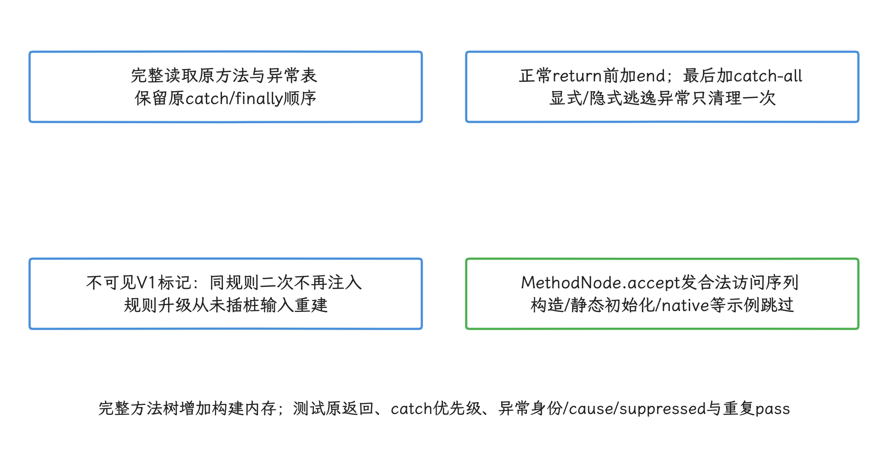

图：自动monitor进入在同步方法体之前；section测方法体执行范围，不自动包含锁获取等待。

生产visitor还需按注解、大小、访问标志和业务规则缩小范围。示例V1标记只保证同规则重复处理；规则升级应从未插桩输入重建或明确拒绝旧标记，不能累叠。tag截断/UTF-16代理对需测试，短哈希也不是无冲突证明；构建产出的完整ID映射须检查重复ID，不同方法冲突则失败或扩展ID。UTF-16 代理对是 Java `String` 用两个 16 位单元表示部分 Unicode 字符的编码方式，截断时不能从中间切开。

Android 17 的 [`android.os.Trace`](https://android.googlesource.com/platform/frameworks/base/+/refs/tags/android-17.0.0_r1/core/java/android/os/Trace.java)与公开 [Trace API](https://developer.android.com/reference/android/os/Trace)规定：同步 section 必须在同一线程成对并正确嵌套，名称上限为 127 个 UTF-16 code unit。code unit 是 Java `String` 的一个 16 位编码单元，它与用户看到的字符数并不总是一一对应。

示例在构建期生成固定 tag，把竖线、换行和空字符替换掉，避免每次调用时拼接字符串。若 tag 包含业务参数、URL、账号或内容摘要，trace 文件也会携带这些信息，因此只应使用低敏感度的稳定标识。

`Trace.isEnabled()` 从 API 29 提供。固定字符串的 `beginSection()` 可以直接调用，因为平台内部会检查 tracing 状态；只有运行时需要构造临时对象或格式化字符串时，才值得先调用 `isEnabled()` 避免无效分配。

<!-- gracker-diagram: a297-07-trace-tag-unicode-and-id-mapping -->
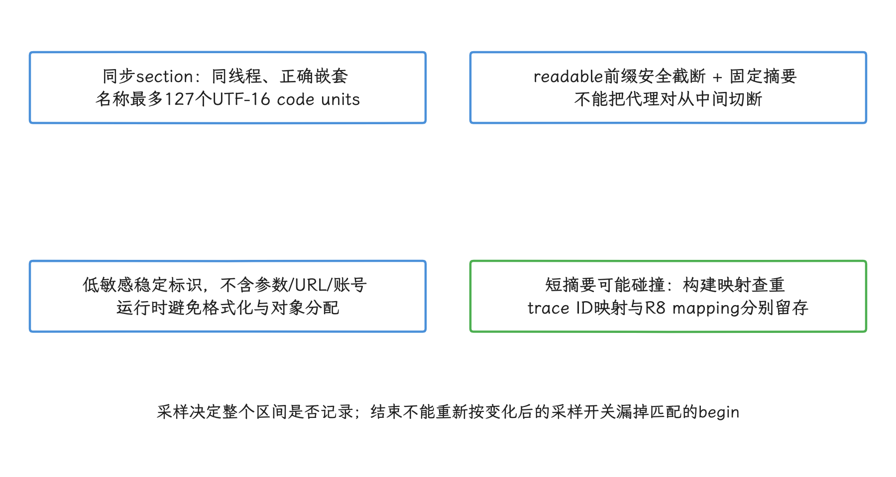

图：Trace.isEnabled从API29公开；固定tag直接beginSection由平台检查启用状态。

## 选择性插桩比全量插桩更可靠

方法数量不能直接决定开销。成本还与调用频率、tag 构造、采样逻辑、R8 优化结果、CPU 和是否正在采集 trace 有关。文章不应给出通用的“每方法增加多少字节”或“每次调用多少微秒”。

可用的筛选维度包括：

- variant：开发、性能测试、灰度和生产可采用不同规则；
- 模块与包：默认只处理自有代码，依赖库必须逐版本验证；
- 类与方法：注解、接口、访问标志和稳定签名共同决定；
- 热度：循环体、高频 getter、Compose 编译器生成方法和协程状态机应谨慎；协程状态机是 Kotlin 编译器为保存挂起点和局部变量而生成的 class。
- 采样：运行时桥接可按会话、场景或设备分群启用，但不能改变 begin/end 配对；
- 预算：用本项目的 clean build、增量 build、APK/Dex 和基准测试建立门禁。

注解只用于构建期选择时，`Retention.BINARY`/Java `RetentionPolicy.CLASS` 足够。ASM 在 R8 前读取注解，运行时无需保留。只有运行时代码仍通过反射读取注解时，才需要对应的 `-keepattributes` 与成员规则。

## 与 R8 的关系

AGP Instrumentation 产生的 class 会继续进入 D8/R8。需要区分三类情况：

- 注入的是直接方法调用：R8 能从调用关系找到桥接类，通常无需为整包添加 `-keep`。
- 桥接类通过反射或 JNI（Java/Kotlin 与原生 C/C++ 代码互调的接口）按名称查找：R8 无法从普通调用图推导目标，需要精确的 keep 规则。
- 监控要求与源码方法一一对应：R8 的内联、合并、删除和 outlining 会改变发布产物中的执行形态。outlining 是把多个位置的重复指令抽成共享方法的优化；必须在 minified release（经过压缩和优化的发布构建）上验证 trace，不能只检查未优化 class。

若 trace tag 保存插桩前的类名，它可以帮助阅读源码，也可能暴露内部命名。另一种方案是使用稳定 method ID，并随构建产出一份受控的“ID 到源码符号”映射。崩溃栈仍使用 R8 `mapping.txt` 还原，两种映射要分开保存和授权。

不要为了保留 trace 结构而对整包禁用优化。更合适的顺序是缩小插桩范围、确认关键方法在 release 中的形态，再为确有需要的少量边界设置规则。

<!-- gracker-diagram: a297-08-r8-release-shape-and-mapping -->
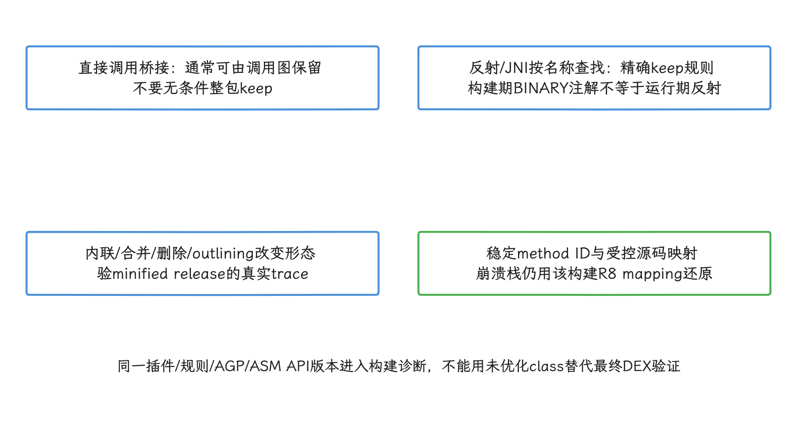

图：先缩范围与验证发布形态，再为确有必要的边界加规则；不为监控一概禁用优化。

## 网络监控：优先使用稳定扩展点

OkHttp 已提供 application interceptor、network interceptor 和 `EventListener`。interceptor（拦截器）可以在请求执行前后读取或调整请求与响应，`EventListener` 则按 DNS、连接、TLS、请求和响应等阶段报告事件。

能在依赖注入容器或 client factory（统一创建网络客户端的工厂）中集中配置时，应使用这些公开扩展点。字节码插桩适合补齐无法统一管理的自有调用点，例如把特定构造或 factory 调用改写到一个版本化桥接方法。

直接修改 `OkHttpClient.Builder` 的私有字段或重写依赖 jar 内部 `build()` 有几项风险：

- 字段名、可见性、Kotlin 实现和构造流程属于库的内部细节，升级时可能改变；
- `InstrumentationScope.ALL` 可能对同一依赖重复处理；
- 多个插件可能改变 visitor 顺序，导致重复 interceptor；
- shaded 依赖、不同主版本和厂商分支的 owner/descriptor 可能不同；shaded 指库在打包时改写了依赖的包名，owner 是声明方法的类，descriptor 是 JVM 编码的方法参数与返回类型；
- 监控 interceptor 自己发请求时可能形成递归。

调用点变换必须同时匹配 owner、方法名和 descriptor，并在不支持的库版本上停止变换或给出构建错误。桥接层要保留请求成功、失败、取消和重试的语义，不采集授权头、Cookie、请求体、完整 URL 查询参数等敏感数据。

`HttpURLConnection` 也不应依赖“某 Android 版本默认切换到 Cronet”之类假设。boot classpath 是系统启动时提供给 App 的核心 framework class 集合，App 构建期 visitor 无法修改其中的 `URL` 或其他系统实现。

包装返回对象还可能破坏调用方的具体类型转换。若工程仍使用 `HttpURLConnection`，优先在自有网络抽象层计时，或只改写已经验证的自有调用点。

## 帧与主线程监控：不要修改 framework class

`Choreographer`、`ActivityThread` 和 `Looper` 属于 Android framework。普通 App 的 AGP 插桩只处理 App 与所选依赖的 class，不能改写设备上的 boot classpath。

运行时反射或 ART hook（在应用运行时替换方法入口）会受隐藏 API、版本差异和完整性策略影响，不应作为常规生产方案。

隐藏 API 是系统保留、未向普通 App 承诺兼容性的接口。

帧问题优先使用：

- [JankStats](https://developer.android.com/topic/performance/jankstats)：按Window提供帧时长、库自身的jank启发式判断和App UI状态；该标记不直接等于SurfaceFlinger实际呈现deadline miss；
- `FrameMetrics` / `FrameMetricsAggregator`：面向 View 窗口的帧阶段数据；
- Macrobenchmark 与 Perfetto：Macrobenchmark 会在设备上重复运行用户场景，再分析 UI thread（执行界面逻辑的主线程）、RenderThread、SurfaceFlinger 和系统调度；
- Android vitals：观察用户侧慢会话与 jank 分布。

刷新率可能动态变化，不能固定以 16.6 ms 判断所有设备和场景。字节码插桩在这里更适合给自有的列表绑定、图片解码、状态更新或业务事务加稳定 trace，用时间关系帮助定位慢帧附近执行了什么。

`Looper.setMessageLogging()` 是公开 API，但一个 Looper 只有一个当前 `Printer`，后设置者会替换先设置者。它还处于消息分发热路径，也就是每条主线程消息都会经过的高频路径。

若需要使用，应由统一初始化组件协调，并把回调工作限制为轻量记录。为初始化一项监控而修改 `Application.onCreate()` 字节码，通常不如显式声明 App Startup initializer（由 AndroidX Startup 负责调用的初始化器）清晰。

<!-- gracker-diagram: a297-09-library-extension-versus-framework-boundary -->
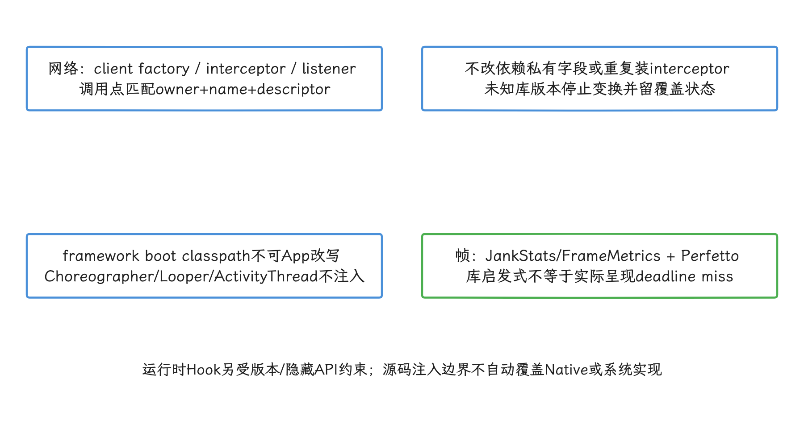

图：Looper.setMessageLogging仅一个当前Printer，统一初始化协调；自有业务slice帮助解释慢帧。

## Kotlin、协程与 Compose 的特殊形态

Kotlin 默认参数、`inline`、`suspend`、lambda 和 synthetic accessor 会产生与源码不同的方法。synthetic accessor 是编译器为访问受可见性限制的成员而生成的辅助方法。

协程函数的主要执行逻辑可能位于生成的 `ContinuationImpl.invokeSuspend()`，一次源码调用也可能跨线程恢复多次。仅按源码函数名插入同步 `Trace.beginSection()`，无法表达跨线程生命周期。

要描述跨挂起/跨线程的逻辑协程生命周期时，用异步trace或能传播关联信息的tracing API；同步section仍可记录每次物理线程执行片段，但多个片段不能当成一个连续生命周期。关联信息传播是让同一个标识跟随协程切换线程；并发实例还要分配不会冲突的 cookie 或 flow 标识，用来把不同线程上的开始与结束事件配成一组。

同步 section 只描述当前线程上的一段执行。

<!-- gracker-diagram: a297-10-coroutine-logical-and-thread-segments -->
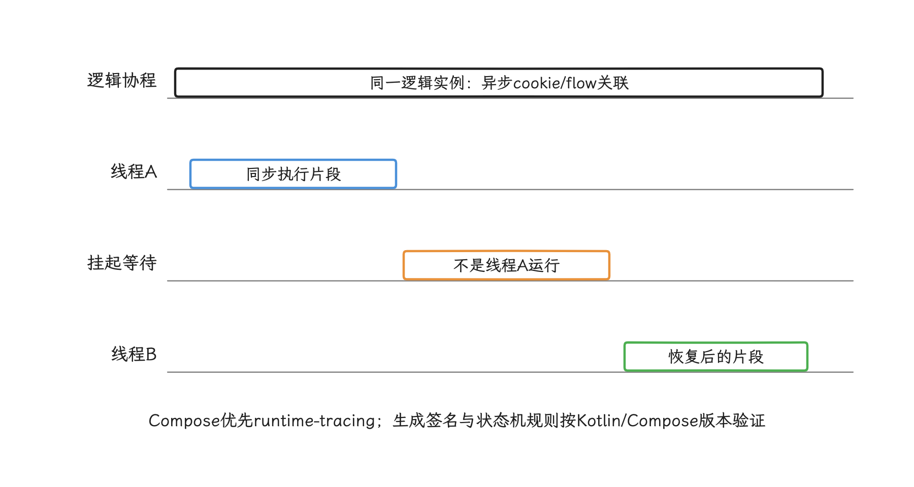

图：物理方法片段可以同步成对结束；把挂起等待和另一线程恢复包进一个同步section会破坏线程语义。

Compose Compiler 会改变 `@Composable` 函数签名并生成重组相关代码。重组是 Compose 在状态变化后重新执行受影响 UI 代码的过程。基于生成参数或内部方法名的 ASM 规则会随 Compose/Kotlin 版本变化。

Composition tracing 已有官方 [`androidx.compose.runtime:runtime-tracing`](https://developer.android.com/develop/ui/compose/tooling/tracing)支持；UI 卡顿仍结合 JankStats、Macrobenchmark 与 Perfetto。只有公开工具无法覆盖且受支持版本集合可控时，才考虑对 Compose 产物做专项 visitor。

## 多模块与依赖范围

Instrumentation 注册在每个 Android 模块的 variant 上。根工程插件可以统一应用配置，但仍需对 application、library、dynamic feature 和 test 模块分别注册适配的 Android Components 扩展。

dynamic feature 是按需交付、独立编译的动态功能模块，它不会自动继承 application 模块上的 visitor。

推荐的范围策略是：

- 自有 library 使用 `PROJECT`，在 AAR（Android 库归档）生成前处理该模块 class；
- application 默认使用 `PROJECT`，避免再次处理已插桩 library；
- dynamic feature 单独应用同一插件，确保规则版本一致；
- 只有明确要修改未插桩依赖时，application 才使用 `ALL`，并设置依赖坐标、class 和方法签名白名单；
- 跨类全局分析使用 Scoped Artifacts 独立 task，并为它比逐 class visitor 更高的构建成本预留预算。

插件版本、规则版本、AGP 版本和 ASM API 版本都应写入构建产物或诊断信息。多插件共同处理 class 时，还要用集成测试固定注册顺序和最终结果。

<!-- gracker-diagram: a297-11-multi-module-idempotence-and-reproducibility -->
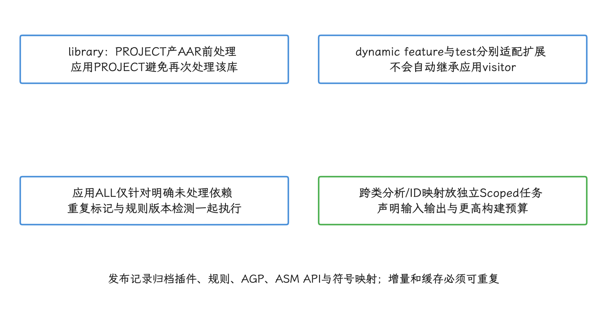

图：多插件顺序、AAR保存标记、版本升级与最终产物由集成测试验证；单次JVM fixture不证明整个AGP链路。

## 验证一套插桩规则

### class 级测试

给 visitor 准备包含正常返回、多个 return、显式 throw、被调用方法抛异常、try/catch/finally、synchronized、宽类型返回值和大方法的 fixture。fixture 是内容固定、用于重复测试某条变换规则的样例 class。验证项包括：

- `CheckClassAdapter` 不报告 verifier 问题；verifier 是 JVM/Android 运行时在执行前检查字节码类型与控制流是否合法的验证器；
- class 可由隔离 ClassLoader 加载和执行；ClassLoader 是把 class 字节定义成运行时类的加载器，隔离加载可避免测试进程中已有同名类干扰；
- 正常与异常路径的 begin/end 数量相等；
- 原返回值、异常类型、异常 cause（原因异常）和 suppressed（随主异常保留的附加异常）信息不变；
- 已插桩输入再次经过插件时不会重复注入。

`ClassWriter.COMPUTE_FRAMES` 能修正 frame，不能证明业务语义没有改变。测试仍需执行变换后的 class。

### Android 构建集成测试

用 Gradle TestKit 或样例工程覆盖 clean build（不复用旧产物的完整构建）、incremental build（只重做受改动影响部分的增量构建）、`configuration cache`（复用 Gradle 配置阶段结果）、`build cache`、不同 variant、多模块和依赖范围。

随后构建 minified release，让 D8/R8、desugar 与 DEX verifier 参与验证。

产物检查至少包含：

- APK/AAB（安装包与 Android App Bundle）和各 DEX 的大小变化；
- R8 `mapping.txt`（混淆名称映射）、seeds/usage（保留项与删除项报告）和插桩 ID 映射是否随构建归档；
- 目标调用是否存在，排除类是否未被修改；
- Debug 与 Release 的启用规则是否符合配置；
- 依赖升级或 AGP 升级后，owner/descriptor 是否仍匹配。

### 设备与性能验证

在 Android 8 到 Android 17 的代表设备或模拟器上运行关键场景，采集 Perfetto 并检查 section 嵌套、线程、异常退出和 R8 后名称。

构建时间、启动、帧、CPU、分配、包体积和上报量使用同一工程的启用/禁用 A/B 结果评估。这里的 A/B 指只改变“是否启用插桩”这一项条件，然后比较两组结果。

门禁阈值来自该工程的基线分布，不使用文章中的固定百分比。样本还要记录设备、系统、编译模式、温度、场景和 trace 是否启用，否则不同实验不能直接比较。

<!-- gracker-diagram: a297-12-semantic-build-and-device-validation -->
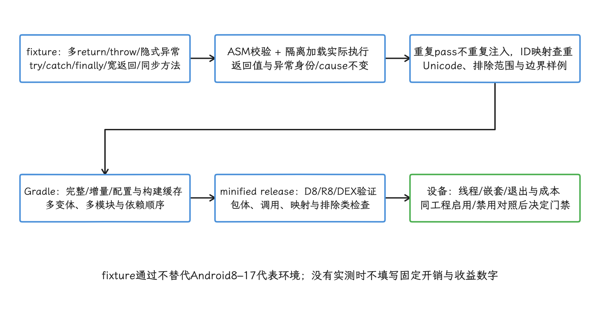

图：COMPUTE_FRAMES不是业务语义证明；主机class测试、AGP集成与设备性能测试有独立范围。

## 运行时桥接的安全要求

插桩代码只调用参数少、职责单一的接口，采样与存储等复杂策略留在版本化桥接层。桥接层应满足：

- 可快速关闭，失败时不阻塞业务；
- 不在主线程执行文件或网络 I/O；
- 不记录密钥、访问令牌、正文、完整 URL 或用户输入；
- 有递归保护，监控 SDK 自身不再触发同类监控；
- 处理采样、缓冲上限、背压和进程退出；背压是下游写入或上传变慢时，限制上游继续产生日志，避免内存无界增长；
- 事件包含 schema、插件、规则、App 和 Android 版本；schema 是事件字段、类型与兼容规则的版本化定义；
- 监控异常独立计数，不用吞掉业务异常来维持上报。

Android trace 通常用于短时诊断，不应把每个方法的原始事件长期上传。生产环境需要聚合时，优先保存场景级耗时、计数、分位数和低基数状态。

低基数表示字段只有少量可枚举取值，例如页面类型；它比完整 URL 或用户 ID 更适合聚合。

罕见问题可在获得授权并限制采集范围后，通过公开的 `ProfilingManager`、Perfetto 或可重复实验获取更完整证据。`ProfilingManager` 是允许 App 请求系统采集限定类型性能资料的公开 API，结果仍需按隐私与存储策略处理。

<!-- gracker-diagram: a297-13-runtime-bridge-budgets-and-business-semantics -->
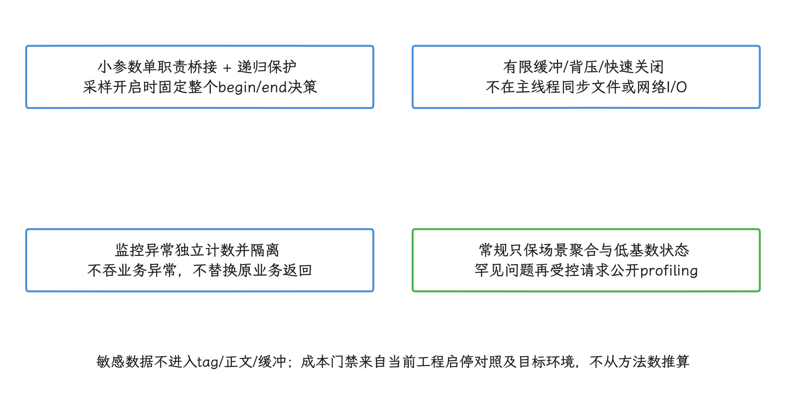

图：原始全方法trace适合短时诊断；事件schema、插件、规则、App与系统版本必须可追溯。

## Android 17 验收清单

- 构建插件使用 `variant.instrumentation`，没有引用已移除的 Transform API。
- factory 无共享可变状态，所有配置都声明为 Gradle 输入。
- 默认 scope 为自有 class；处理第三方依赖时有坐标和签名白名单。
- visitor 覆盖隐式异常退出，且 begin/end 在同一线程正确嵌套。
- 新增控制流后选择合适的 frame computation mode。
- trace tag 不超过公开 API 限制，不包含用户或业务敏感数据。
- 过滤抽象、native、生成类、监控 SDK 自身和不适合处理的热方法。
- 网络监控优先使用客户端公开扩展点，不修改 framework 或依赖私有字段。
- 帧监控使用 JankStats、FrameMetrics、Macrobenchmark 与 Perfetto，不注入 `Choreographer` 或 `ActivityThread`。
- Kotlin 协程与 Compose 使用符合其执行模型的 tracing 方案。
- class fixture、Gradle 集成、minified release 和 Android 设备测试均通过。
- 成本门禁基于当前工程实测，保留可关闭开关和规则版本。

## 全文小结

编译期字节码插桩可以重复执行、检查变更，并在发布前验证。设计时同时约束变换范围、控制流正确性、R8 后产物、运行时成本与数据隐私，才能避免监控代码引入新的稳定性问题。
