# eBPF、ATrace（用户态埋点 API 与事件协议） 与线上系统追踪

线上排障通常从日志、应用埋点和短时间的 system trace 入手，可系统调用和 Binder 这一段，常规手段看不全。在具备系统权限的设备上，我们可以用 ftrace 或 eBPF 补上这一段：ftrace 是 Linux 内核自带的事件追踪框架；eBPF 是在内核内运行、先经安全校验的受限程序；Binder 则是 Android 最主要的进程间通信（IPC）机制。这里的“在线”指设备运行期间持续或按条件追踪；商店发布包里的普通应用，仍拿不到自行加载 BPF 程序的权限。

> 源码基线：AOSP `android-17.0.0_r1`；内核 Binder 接口与追踪事件核对到 `android17-6.18-2026-06_r39`，适用 Android 12～17。文末保留的 r6 链接是原历史锚点，经复核三个 Binder 文件与 r39 一致。

WOOTdroid 的正式实验跑在两台已 root（取得超级用户权限） 的 Pixel 9 上，系统为 Android 16；论文另用 Pixel 7 和 Pixel 9 检查逐系统调用 tracepoint 的可用性。要把这些结果挪到 Android 17 量产 user build、其他 SoC 或厂商内核上，得重新验证一遍。

设备厂商的系统集成、开放额外调试能力的 userdebug 测试机和经过授权的安全实验，用得上这类能力；普通应用的线上诊断，优先用应用日志、系统管理的性能分析 API `ProfilingManager`、Android Vitals，以及用户授权生成的 bugreport（系统诊断包）。

所以线上系统追踪始终是在信号价值、权限、开销和隐私之间做取舍：eBPF 在内核侧重建调度或 Binder 事件；Profilo 这类端侧框架靠 ATrace 等数据源组织短窗口 Trace——ATrace 既是用户态埋点 API，也是一套事件协议。

<!-- gracker-diagram: a299-01-kernel-and-process-evidence-scopes -->
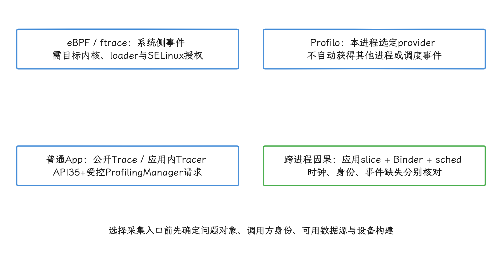

图：root Pixel研究结果不能外推Android17量产user；Device Owner也不提供任意BPF加载权。

## 内核 Hook、Binder 关联与事件预算

内核侧追踪要解决三件事：把钩子挂到正确的位置，把 Binder 事件和调用语义对上，再把事件预算管住。我们先从 ftrace 说起。

### ftrace 的能力与事件丢失边界

调度、频率、Binder 和 I/O 这些内核事件，我们最常用 ftrace 来观察——它是 Android / Perfetto 系统追踪的重要数据源。事件通常写进“每 CPU 缓冲区”，即每个处理器核心各自维护的环形存储区；读取端消费不及时、空间又耗尽时，较早的事件就可能被覆盖。做短时间人工诊断时，扩大缓冲区、缩小事件集、控制复现步骤，就能把丢失风险压低；换成常驻审计，还要管住持续事件率、读取阻塞、存储占用和耗电。

Binder 驱动自带 `binder_transaction`、`binder_transaction_received`、`binder_command`、`binder_return` 等 tracepoint——内核预先定义、供追踪工具订阅的事件点。要看事务路由和驱动阶段，用它们正合适；只是它们不带完整的 `Parcel` 参数，也谈不上 Android 应用 SDK 的稳定契约。

所以若要还原方法含义，还得建立 transaction code（接口内的方法编号）与具体接口版本之间的映射。

WOOTdroid 关注的系统调用审计是另一条路：WDSys 在 eBPF 侧过滤并编码事件，再通过 perf buffer（BPF 的事件传输缓冲区）交给用户态进程。论文让它与基于 ftrace 的系统调用追踪同时运行，比较两份日志。这个实验说明缓冲和读取架构会影响观察结果；至于哪个方案拿到了全部事件，还缺一份独立真值——一份能确认所有应出现事件的第三方记录，实验里并没有。

生产追踪至少要记录下面这些健康度：

| 维度 | 要回答的问题 | 约束 |
|---|---|---|
| 窗口与触发 | 常驻摘要、故障前滚动窗口，还是人工抓取 | 明细窗口有时长、事件类型和设备范围限制 |
| 内核侧丢失 | map（内核与用户态共享的键值存储）更新、perf buffer 输出或 BPF ring buffer 空间预留是否失败 | 每条丢失路径分别计数，计数器本身也要防溢出 |
| 用户态积压 | 读取进程（reader）的延迟、队列长度和落盘速度是否恶化 | 达到项目阈值后停止参数采集或关闭追踪 |
| 关联完整性 | 进入/退出事件（enter / exit）、请求/接收事件和应用阶段能否匹配 | 缺失一端时标记为 partial（记录不完整），不补造时长 |
| 权限来源 | root、userdebug、OEM 系统镜像分别允许什么 | 能力报告必须带构建类型（build type）、内核和策略版本 |
| 数据类别 | 只保留元数据，还是读取 Parcel 内容 | 参数读取默认关闭，并由接口白名单和授权控制 |

这里要分清两件事：“没有观察到事件”只说明这套采集流程没有产出该事件；要进一步认定“事件没有发生”，得先确认丢失计数、过滤规则和权限状态都是完整的。

<!-- gracker-diagram: a299-03-buffer-loss-and-observation-health -->
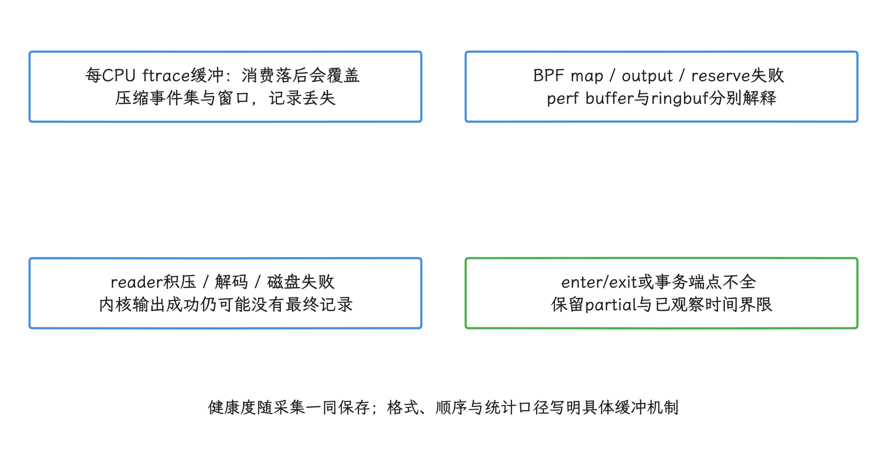

图：没有事件记录不证明事件未发生；没有可读丢失计数也不能默认完整。

### Android eBPF 系统调用追踪路径

Android 平台自己就在用 eBPF。按 AOSP 文档的说法，系统镜像中的 BPF 对象由 Android BPF loader 在启动阶段加载，所需的 map 和 program 会 pin 到 BPF 文件系统——pin 就是给内核对象建一个持久路径，loader 退出后其他进程仍可按权限访问。`system/bpf` 源码还显示，平台程序受 loader 描述项和文件权限管理，带 `skip_on_user` 标记的对象在 `ro.build.type=user` 时会被跳过。

这种加载能力属于系统集成机制：普通应用就算把编译后的 `.o` 对象文件放进自身目录，也换不来加载权。

WDSys 的论文原型可以拆成五个阶段：

1. **入口**：论文作者在 Pixel 7 和 Pixel 9 上没有找到可用的逐系统调用 tracepoint，于是改挂 `raw_syscalls:sys_enter` 与 `raw_syscalls:sys_exit`，再按 syscall id（系统调用编号）分派。这个观察只代表这两台设备；Android 12～17 的其他内核是什么情况，部署前要先枚举目标内核实际提供哪些 tracepoint 才知道。
2. **过滤与配对**：enter 事件保存参数，exit 事件保存返回值。过滤器按 UID（应用或系统主体标识）、TGID（Linux 线程组标识，通常对应进程）、syscall id 和项目规则筛掉无关事件。配对并不总成功：线程提前退出、tail call（从一个 BPF 程序直接跳到另一个程序） 失败，或 map 更新与查询失败，都可能让记录只剩进入或退出一侧。
3. **复杂度分段**：论文用 program array（一张保存 BPF 程序引用的 map） 和 tail call 拆分逻辑，以满足 verifier 的限制——verifier 是内核在加载前执行的安全检查器，对栈空间和程序复杂度设有上限。tail call 只是这个原型的程序组织方式，Android 系统调用追踪协议并没有规定必须这样实现。
4. **传输**：WOOTdroid 使用 perf buffer，论文也称它 perf ring buffer。`BPF_MAP_TYPE_RINGBUF` 是另一种 BPF map 类型；两者在空间预留、事件提交、跨 CPU 顺序和丢失统计上都不同，设计文档应写明用的是哪一种。
5. **用户态消费**：读取进程负责拼接分片、统一时间表示、落盘和审计。内核程序成功输出，只说明事件进了传输缓冲区；读取进程有没有消费并持久化这些数据，还要单独确认。

读取带 tag 的用户地址是另一个设备相关的问题。论文的 Pixel 原型为此用了固定按位掩码：tag 指 arm64 可以放在地址高位的标记，TBI（Top Byte Ignore）让处理器忽略地址最高字节，MTE（Memory Tagging Extension）用标签检测内存访问错误。这个掩码常量依赖所测设备的虚拟地址布局，直接当成 Android 17 的通用方案是有风险的。

<!-- gracker-diagram: a299-02-wd-sys-filter-tail-call-reader -->
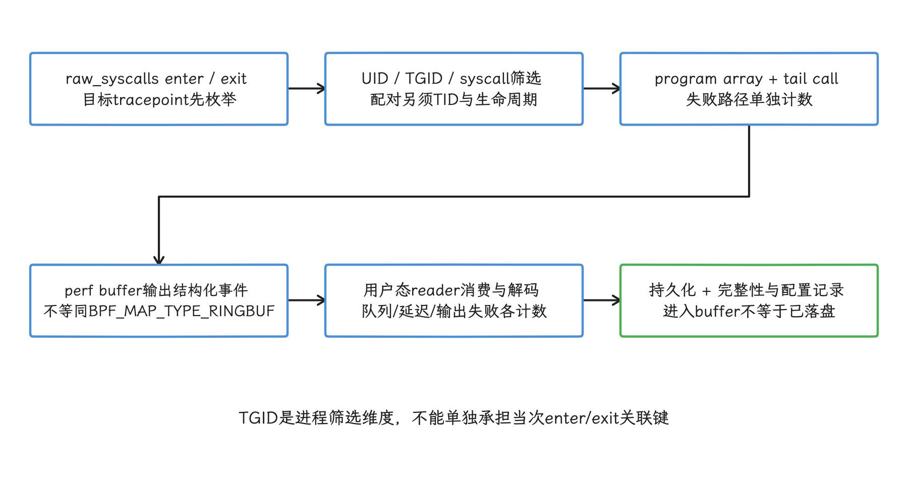

图：map、tail call、输出、解码、落盘分别留错误；缺一端保partial，不补造时长。

去除地址标签之前，要把目标 arm64 内核、TBI/MTE 配置、BPF helper（内核提供给 BPF 程序的受控函数） 的行为和进程 ABI（应用二进制接口） 放在一起验证；验证失败时只记元数据，用户缓冲区一概不读。

把这些环节串起来看，eBPF 在这里扮演的是内核侧筛选器：尽早排除无关事件，只送出长度有上限的结构化数据。字符串、用户栈和可变长 payload（事件携带的数据内容） 都会推高校验、内存读取、传输带宽和隐私成本；程序跑在内核里，这部分开销省不掉。

### Binder 语义重建的关键问题

先看一次普通的应用调用是怎么走进 Binder 的：应用调用 AIDL Proxy 后，接口 token 和参数按该接口版本的规则写进 `Parcel`，再由 `IBinder.transact()` 进入 Binder 驱动。这条链路上的几个词我们先摆清楚：AIDL 是 Android 接口定义语言，Proxy 是 AIDL 工具生成的客户端代理，`Parcel` 是 Binder 用来顺序编码参数的二进制容器，接口 token 通常是标识接口的 descriptor 字符串。

驱动只认这几样：transaction code、flags（同步、oneway 等事务标志）、目标 handle（进程内的 Binder 引用编号）、数据缓冲区和对象 offsets（特殊 Binder 对象在缓冲区中的位置表）。方法名与 Java/Kotlin 参数类型都不在 Binder 内核 ABI 里，这层语义驱动给不出，要在用户态重建。

这层接口的具体形状，可以从 `include/uapi/linux/android/binder.h` 核对 Android 17 / 6.18 的 UAPI（内核向用户空间公开的二进制接口）：`BINDER_WRITE_READ` 的参数是 `binder_write_read`，其中 `write_buffer` 指向一串 Binder 命令；`BC_TRANSACTION` 和 `BC_TRANSACTION_SG` 后面跟着大小不同的事务结构。

驱动的 `binder_ioctl_write_read()` 先用 `copy_from_user()` 读取 `binder_write_read`，再分别处理写入与读取部分。ioctl 我们不陌生：进程通过文件描述符向设备驱动发控制命令，走的就是这个系统调用。

WDBind 在 `raw_syscalls:sys_enter` 事件中运行于内核态，读到的数据却来自调用进程的用户地址。它观察的是驱动执行 `copy_from_user()` 之前的 `binder_write_read` 和 `Parcel`，还未经过驱动复制、校验和 Binder 对象重写；于是采集器读到的字节与驱动稍后使用的字节之间，可能出现 TOCTOU（检查与使用之间数据被改动）、短读、地址标签和 ABI 兼容风险。

顺着这条链路，语义重建可以分成四层：

| 层级 | 可验证的数据 | 仍然缺少什么 |
|---|---|---|
| syscall | `ioctl` 参数、返回值、PID / TID（进程/线程标识）与时间 | fd（文件描述符）是否指向 Binder 设备、命令流内容与事务结果 |
| Binder UAPI | `BINDER_WRITE_READ`、命令字、transaction code、flags、数据长度 | Java 方法名与字段类型 |
| Parcel | interface token、字节序列、对象 offsets | 当前接口版本对应的参数布局 |
| 签名表 | descriptor、transaction code、方法与参数类型 | 厂商（vendor）接口、动态注册接口以及复杂自定义序列化 |

要做成一套可审计的解析过程，至少要完成这些检查：

1. 证明 fd 对应正确的 Binder 设备节点；只凭 ioctl cmd 数值相同，认定不了那就是 Binder。
2. 校验 `write_size`、指针、命令边界和单次读取上限；一个 write buffer 可以包含多条命令。
3. 按目标 UAPI 同时识别 `BC_TRANSACTION`、`BC_TRANSACTION_SG` 等已支持命令；碰到未知命令就停掉当前段解析，偏移不要靠猜。
4. 检查 `data_size`、`offsets_size` 和对象位置是否满足大小上限及 ABI 要求的内存边界。读取失败时保留 transaction code、大小与错误类型。
5. 用与 `Build.FINGERPRINT`（完整系统构建标识）、AIDL 接口版本和采集器版本绑定的签名表解码；同一个 transaction code 换个系统版本，可能就对应另一个方法，这层对应交给签名表兜底。

WOOTdroid 论文在设备上用 Java reflection（运行时反射）生成 Android framework（系统框架） 的 AIDL 签名表。原型能解析基本类型、`String` 和部分 Binder 对象，也就到此为止：fd 或指针指向的内容不再展开，事务回复（transaction reply）同样不处理；复杂 `Parcelable`（可写入 `Parcel` 的结构化对象）、厂商接口和动态注册接口都没有系统性覆盖，论文因此把 WDBind 的完整性和性能评估列为后续工作。

<!-- gracker-diagram: a299-04-binder-user-memory-to-signatures -->
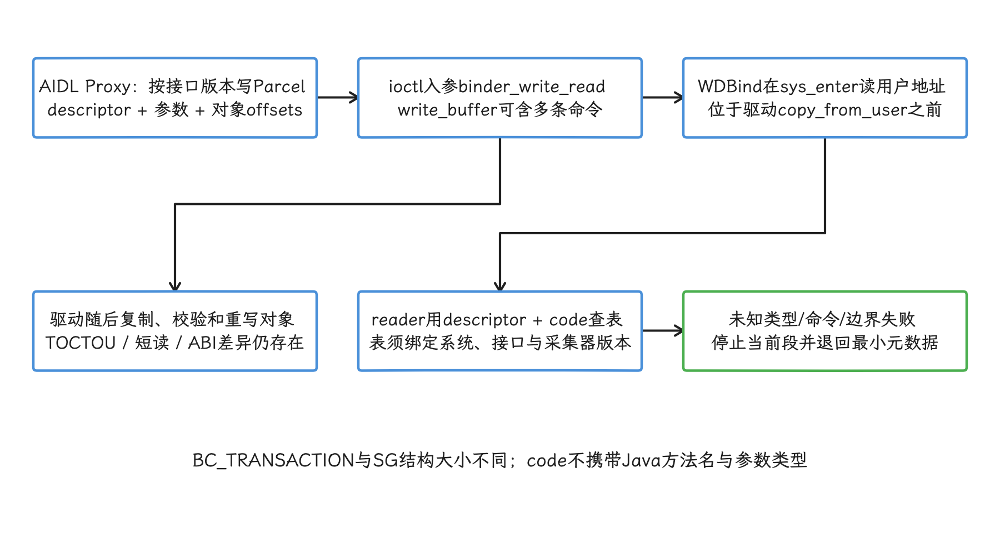

图：图示对比观察与使用的边界；并非WDBind v1已经完整实现全部校验或所有命令。

如果我们要的只是路由和时序、用不着参数内容，Binder tracepoint 反而更合适：`binder_transaction` 给出事务调试编号、目标进程或线程、reply 标记、code 和 flags，`binder_transaction_received` 表示目标侧收到事务。只是别忘了它们的限制：仍受 ftrace 权限和缓冲区约束，而且这些字段属于内核追踪接口，应用 API 的稳定性保证罩不到它们。

那一次 Binder RPC（远程过程调用）到底有多长？要把客户端应用 slice、Binder transaction / received 事件和服务端 slice 分段拼起来才能算出来，`BINDER_WRITE_READ` 的 ioctl 时长给不出这个数：一次 ioctl 可以写入多条命令，也可能进入读取路径等待工作，oneway transaction（单向事务）也不同步等回复。slice 是 trace 中带开始与结束时间的一段任务区间；缺少关联点时，我们只报告已经观察到的区间。

<!-- gracker-diagram: a299-05-binder-rpc-observation-tracks -->
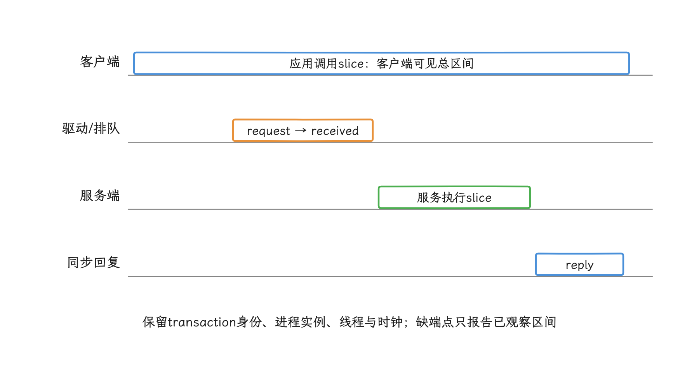

图：同步调用需关联request、received与reply；单次BINDER_WRITE_READ可批量写入或等待读工作，不能等同一次RPC。

### 性能开销与完整性指标

WOOTdroid v1 的数据适合用来理解实验方法，离产品预算还远。论文用独有事件率（Unique Event Rate，UER）衡量两个采集器各自多记录了多少事件：

| 项目 | 论文结果 | 解读限制 |
|---|---|---|
| Geekbench 6 | WDSys 单核分数下降 3.6%，多核下降 0.9%；ftrace 对照为 5.9% 和 2.9% | Geekbench 6 是 CPU 性能基准；实验使用两台已 root 的 Pixel 9、Android 16，并重复十次。这里只评估 WDSys，不能代表 WDBind 的开销 |
| 自动交互 | 数据集是当时 Google Play 各类别最常用的 100 个免费应用；每个应用注入 1000 个 Monkey 输入，间隔 500 ms | Monkey 是 Android 随机生成触摸、按键等输入的测试工具；覆盖受数据集、安装结果和随机路径影响，不能代表业务场景覆盖 |
| UER | WDSys 均值 37.75%，ftrace 均值 4.27%，相差 33.48 个百分点 | 某采集器的 UER = 只有该采集器记录到的事件数 ÷ 两份日志的事件并集；该指标不能表示绝对召回率（所有应采事件中成功采到的比例），也不能作为独立测得的丢失率 |

ftrace 的 UER 非零，说明有些事件只出现在 ftrace 日志里；WDSys 同样有残余缺失，写成“完整捕获”就名不副实。论文摘要里那句“多追踪 33%”也要按 UER 的定义理解，准确说法是两者平均 UER 相差 33.48 个百分点。

<!-- gracker-diagram: a299-06-unique-event-rate-union-denominator -->
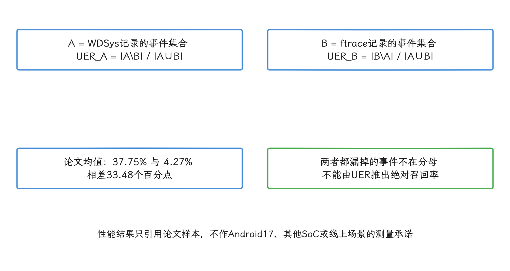

图：两台root Pixel9、Android16；Geekbench WDSys数据不代表Binder参数解码或本项目开销。

换成我们自己的项目，评估要覆盖四类数据：

- **带独立真值的完整性**：在受控进程中注入带序号的事件，把 enter / exit、transaction / received 和读取结果逐级核对。
- **每条失败路径**：分别统计 BPF map 冲突、tail call 失败、缓冲空间预留或输出失败、用户态解码失败和落盘失败。
- **业务扰动**：在目标设备组合上测 CPU、内存、存储 I/O、耗电、温度、启动、帧和 ANR；阈值由产品预算决定。
- **单独测量 WDBind**：Parcel 读取与解码的事件率、最大 payload、复杂接口比例和失败分布，都得单独测，WDSys 的 Geekbench 数字借不过来。

### 用于 ANR、隐私审计和冷启动回溯

这一节我们把内核侧这条线放进三个具体场景：ANR 回放、隐私审计、冷启动回溯。eBPF 与 Binder 语义只在权限和数据治理都允许的受控设备上补证据。

#### ANR 与卡死回放

排查 ANR 或卡死时，主线程栈停在 Binder 等待只说明采样那一刻在等 IPC。要把客户端调用前耗时、驱动路由、服务端排队、服务端执行、回复这五段拆开看，就得有多侧时间点。

在受控设备上，我们可以组合这几类证据：

- App slice：调用点、线程、业务阶段和客户端总耗时。
- Binder tracepoint：transaction code、目标进程/线程、事务发送与接收阶段。
- WDBind 语义解析：在允许读取 payload 时提供接口 descriptor（接口标识）、方法候选和解码状态。
- 调度、I/O 与 futex 事件：用于判断客户端或服务端线程在相关区间是否获得 CPU、等待锁或执行 I/O。futex 是 Linux 在用户态快速竞争、必要时进入内核等待的同步机制，许多锁最终会用到它。

WDBind v1 不处理 reply，ioctl enter / exit 又可能混合 write 与 read，单靠它输出 request / reply latency 是办不到的。`/sys/kernel/debug/binder/` 还需要特权，格式和可用性都在 Android 应用契约之外，发布包方案里别依赖它。

#### 隐私审计

做隐私审计时，我们要的答案通常是“哪个 UID 在何时调用了哪个敏感接口”，参数正文本身无需保存。WOOTdroid 案例正对着这个用途：它重建了十个安全相关的 framework 方法，覆盖短信、电话、包管理、权限、账户和通知场景。它证明的是原型能在所测 Android 16 设备上解析这批样例；样例之外的其他 Binder 接口，还在这个证明的范围之外。

顺着这个目标，解码策略默认把内容丢掉：

| 数据类别 | 默认处理 |
|---|---|
| token、密码、认证材料 | 不读取或立即丢弃，禁止写日志 |
| 短信、剪贴板、通知、联系人正文 | 不落盘，仅记录接口、结果类别和调用计数 |
| 电话、账户、设备标识 | 默认不记录值；业务确需关联时使用受控令牌化（用无业务含义的随机令牌代替原值）。输入范围很小、容易穷举的值不能靠普通 hash 冒充匿名化 |
| 精确位置、SSID/BSSID | SSID 是 Wi-Fi 网络名称，BSSID 通常标识具体接入点；这些值默认丢弃，安全用例只保留经审批的粗粒度分类 |
| 包名与权限名 | 按审计目的建立允许列表，其他值使用稳定分类或聚合 |
| transaction code、flags、大小、耗时 | 可作为元数据，但仍受保留期和访问控制约束 |

端侧脱敏要发生在持久化和上传之前。原始 Parcel 一进入用户态 reader，敏感数据暴露面就已经扩大，“服务端再清洗”因此满足不了最小化原则。

#### 冷启动回溯

冷启动回溯要拼的东西不少：进程创建、dex/oat 代码加载、资源与文件 I/O、`ContentProvider` 初始化、Binder 查询、权限检查和应用初始化；dex 是 Android 字节码格式，oat 是 Android Runtime（ART） 为安装或运行准备的编译产物。系统调用追踪能看到 `openat`（打开文件）、`mmap`（建立内存映射）、`read`、`futex`、`ioctl` 这些调用，但每段应用代码的业务含义，从这里面看不出来。

较稳妥的组合是：

- 应用埋点提供启动 ID、阶段名和依赖关系。
- Perfetto 把调度、Binder、I/O 与应用 slice 放进同一时间轴。
- eBPF 仅在 OEM/实验设备上补充经过筛选的 syscall 或 Binder 元数据。

三类数据都要记录时钟来源和同步误差；只拿 syscall 序列做归因时，相邻事件之间的时间差不要一股脑记在某个系统调用头上。

### 部署边界与合规风险

自定义 eBPF 不在 Android 应用公开 API 之列，这条路用不用得成，取决于系统镜像、SELinux、BPF loader、内核配置和签名，单靠应用声明权限拿不到。SELinux 是 Android 限制进程和资源访问的强制访问控制机制——就算进程身份合格，策略照样可以拒绝操作。

| 环境 | 能力边界 |
|---|---|
| 普通 user build 应用 | 不能加载任意追踪程序；Android 15 / API 35 起可通过 `ProfilingManager` 请求系统 trace、Java 堆转储、堆分析或栈采样。请求有频控，也不保证执行 |
| adb / userdebug | adb 是 Android 调试桥；userdebug 是额外开放调试能力的系统构建。两者适合验证 Perfetto、ftrace 和实验性 BPF，但不代表量产权限 |
| root 研究机 | 可复现实验，但 root 会改变设备的安全与完整性条件，不能作为普通用户部署方案 |
| OEM 系统集成 | 可把程序、loader 配置、SELinux、用户态采集进程和更新策略纳入系统镜像；需要平台测试与安全审查 |
| 企业受管设备 | Device Owner 是企业设备管理应用的最高管理角色，但该身份不授予 BPF 加载权；仍需 OEM 系统能力或专用调试环境 |

落到部署上，清单至少包括：

- 精确记录构建类型、Android 源码标签、内核版本、BPF helper / tracepoint、Binder ABI、SELinux 策略和采集器版本。
- 参数采集使用显式接口允许列表，未识别接口只保留最小元数据。
- 设备端设定 CPU、内存、缓冲、磁盘和网络预算，并提供远程停止与升级失败回退。
- 用户诊断具备目的说明、范围、到期时间、撤销入口、保留期和删除路径。
- 原始附件加密，服务端按最小权限访问并保留审计记录。
- 系统无线升级（OTA）后重新验证 loader、程序、签名表、MTE / TBI、vendor Binder 接口与数据解析。

### 扩展：WOOTdroid 与 Android eBPF 工具链对比

| 工具 / 方案 | 主要入口 | 适合场景 | 主要限制 |
|---|---|---|---|
| Perfetto / system trace | atrace（Android trace 类别开关）、ftrace 与平台数据源 | 启动、卡顿、调度、Binder、I/O 分析 | 可用数据源和权限会随版本与构建类型变化；它不提供任意 eBPF 程序的装载入口 |
| `ProfilingManager` | 系统管理的分析请求 | API 35 起，普通应用可按条件请求系统 trace、Java 堆转储、堆分析或栈采样 | 有频控和配置限制，请求不保证执行，也不开放全部 Perfetto 配置 |
| Simpleperf | Linux perf 事件与采样 | CPU 热点、原生代码（native）/ Java 调用栈采样 | 事件主要描述 CPU 执行，不能直接重建 Binder 参数 |
| bpftrace / BCC | kprobe、tracepoint、uprobe | root / userdebug 实验室快速验证 | kprobe 追踪内核函数，uprobe 追踪用户态函数；user build 通常缺少权限与完整工具链，探针稳定性取决于目标符号和版本 |
| AOSP 系统 eBPF | BPF loader、系统镜像对象、已 pin 的 map/program | 平台网络、CPU、GPU、内存等系统功能 | 由系统组件与 SELinux 管理，普通应用不能扩展 |
| Binder ftrace tracepoint | Binder 驱动 trace event（追踪事件） | 事务路由、接收与线程分析 | 主要是元数据，没有完整 Parcel 类型语义 |
| WOOTdroid WDSys | `raw_syscalls` + eBPF + perf buffer | 已 root / OEM 环境的系统调用审计研究 | 论文只在 Android 16 Pixel 原型评估 |
| WOOTdroid WDBind | 系统调用入口读取 Binder 写入缓冲区 + 签名表 | 受控安全审计与语义研究 | reply（回复）、复杂类型、vendor 覆盖和性能尚未系统评估 |

把这张表用起来，我们先看权限和问题类型：普通应用从 `ProfilingManager`、Perfetto 与 Simpleperf 开始；要补自定义 eBPF 或 WDBind 的，就只剩受控系统环境。

### 扩展：Binder 参数脱敏策略

参数保护从查表开始：解析器先拿“接口 descriptor + 方法 + 参数序号”查策略，再决定跳过读取、只记录类型与长度、执行令牌化，还是在受控实验中短暂保留；未知接口默认丢弃参数。通用的字符串替换，撑不起这层保护。

策略本身也要版本化，否则 AIDL 增删参数、transaction code 变化或 vendor 接口复用时，旧规则可能把处理套到错的字段上。签名表、脱敏规则、build fingerprint（系统构建标识）和采集器版本必须作为同一份配置发布，任一项对不上就退回元数据模式。

安全实验若必须保留短时间的原始参数，应与生产数据域隔离，并具备明确的设备清单、审批人、加密密钥、到期删除和访问日志。这里容易低估的是匿名化：hash 是把原值映射为固定摘要，geohash 是把经纬度编码为网格字符串，而手机号后四位、未加密钥的普通 hash 和粗粒度 geohash 仍可能成为可关联标识，直接按匿名数据对待有风险。

<!-- gracker-diagram: a299-07-version-bound-semantic-decoding -->
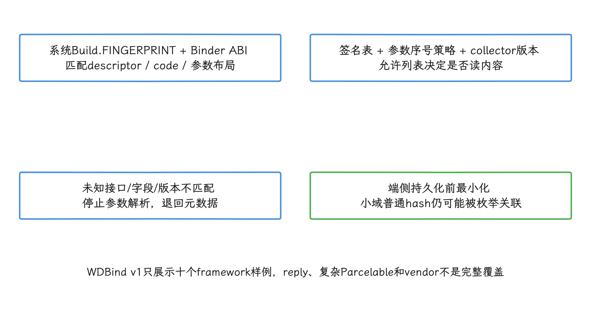

图：原始Parcel一进reader就扩大暴露面；服务端清洗不能替代端侧先最小化。

### 源码与文档锚点

- [Android 17 `system/bpf`](https://android.googlesource.com/platform/system/bpf/+/refs/tags/android-17.0.0_r1/)：平台 BPF loader、program 与 map 的实现入口。
- [Android 17 `bpfloader.rs`](https://android.googlesource.com/platform/system/bpf/+/refs/tags/android-17.0.0_r1/loader/bpfloader.rs)：平台对象描述、`skip_on_user`、加载、附着和 pin 规则。
- [AOSP：Extend the kernel with eBPF](https://source.android.com/docs/core/architecture/kernel/bpf)：系统镜像 BPF 对象、启动加载、pin 与 Android BPF library 的官方说明。
- [Android 17 common kernel 6.18 r39 `binder.h`](https://android.googlesource.com/kernel/common/+/refs/tags/android17-6.18-2026-06_r39/include/uapi/linux/android/binder.h)：当前核验的 `BINDER_WRITE_READ`、`BC_TRANSACTION`、`BC_TRANSACTION_SG` 与 UAPI 结构。
- [Android 17 common kernel 6.18 r39 `binder.c`](https://android.googlesource.com/kernel/common/+/refs/tags/android17-6.18-2026-06_r39/drivers/android/binder.c)：当前核验的 `binder_ioctl_write_read()`、命令处理和用户内存复制路径。
- [Android 17 common kernel 6.18 r39 `binder_trace.h`](https://android.googlesource.com/kernel/common/+/refs/tags/android17-6.18-2026-06_r39/drivers/android/binder_trace.h)：当前核验的 Binder transaction、received、command 与 return tracepoint。
- [Android 17 common kernel 6.18 `binder.h`](https://android.googlesource.com/kernel/common/+/refs/tags/android17-6.18-2026-06_r6/include/uapi/linux/android/binder.h)：原文保留的 r6 历史锚点；复核时与 r39 内容一致。
- [Android 17 common kernel 6.18 `binder.c`](https://android.googlesource.com/kernel/common/+/refs/tags/android17-6.18-2026-06_r6/drivers/android/binder.c)：原文保留的 r6 历史锚点；复核时与 r39 内容一致。
- [Android 17 common kernel 6.18 `binder_trace.h`](https://android.googlesource.com/kernel/common/+/refs/tags/android17-6.18-2026-06_r6/drivers/android/binder_trace.h)：原文保留的 r6 历史锚点；复核时与 r39 内容一致。
- [WOOTdroid v1](https://arxiv.org/abs/2604.27830)：WDSys/WDBind 设计、Android 16 实验数据和作者列出的限制。
- [Android Developers：App-driven profiling](https://developer.android.com/topic/performance/tracing/profiling-manager/how-to-capture)：`ProfilingManager` profile 类型、频控和配置边界。
- [Android Developers：Log Info Disclosure](https://developer.android.com/privacy-and-security/risks/log-info-disclosure)：日志敏感数据泄露风险与端侧处理建议。

## ATrace 采集与 Profilo 数据源、触发和文件管理

内核事件提供底层语义，Profilo 类框架负责会话、触发、缓冲区和上传；两者组合时，我们要先把时钟和事件 ID 统一。

### Profilo 的维护状态与使用边界

[Profilo](https://github.com/facebookarchive/profilo) 是 Meta（原 Facebook）开源的 Android 性能追踪库，目标是从应用的生产构建中采集性能 trace——一段时间内带时间戳的事件记录，可用来还原线程执行、方法区间与系统活动之间的先后关系。

它把一次采集拆成可按需启停的数据采集器（源码称 provider），由触发请求（trigger）决定是否启动，事件先写进固定容量的内存映射环形缓冲区——写满后循环复用旧槽位，内存映射让进程通过虚拟地址访问匿名内存或文件。这些设计到今天仍有参考价值。

不过要先看清它的维护状态：仓库 README 在 2023 年宣布进入维护模式，计划 2023-05-01 完全归档，GitHub 元数据现已标记为 archived；主分支最近提交和最近 release 均为 2023-02-24，README 还明确声明 API 尚不稳定。上游也没有 Android 17 / API 37 的维护承诺或验证记录。

所以继续维护 `fork`——fork 指从上游复制后自行演进的下游仓库——要先回答两个问题：ATrace provider 捕获了哪些事件；它在 `android-17.0.0_r1` 和目标厂商镜像上还按不按预期工作。

“Android 8 到 Android 17 全面覆盖”“生产开销低于 1%”这类说法缺上游基准和 Android 17 测试支撑，当上线依据站不住脚；开销必须按目标设备、事件密度、provider 组合、缓冲区容量和采样时长重新测量。

### Profilo 的组件职责

Profilo 包含多个协作组件。官方[架构文档](https://github.com/facebookarchive/profilo/blob/main/docs/architecture.md)对 trace、trigger、`TraceController` 和 `TraceProvider` 给出了定义：

| 组件 | 源码中的职责 | 不负责的事情 |
|---|---|---|
| `TraceController` / 配置 | 根据一次 trigger 和配置决定是否启动 trace，并选择 provider 与参数 | 不自动决定业务采样策略 |
| `BaseTraceProvider` | 在 trace 开始与结束时启停一种数据源 | 不承诺所有 Android 版本都可用 |
| `MultiBufferLogger` | 把标准记录和字符串写入一个或多个 Profilo 缓冲区 | 不等同于内核的 ftrace 环形缓冲区 |
| `MmapBufferManager` | 分配匿名缓冲区或映射到文件的缓冲区，并登记进程与容量 | 不负责上传 |
| `TraceWriter` / `FileManager` | 从缓冲区生成 trace 文件，并管理待处理文件 | 不内置通用加密或 HTTPS 服务端 |

内存侧使用固定容量的并发环形缓冲区。

并发语义见源码 [`LockFreeRingBuffer.h`](https://github.com/facebookarchive/profilo/blob/main/cpp/logger/lfrb/LockFreeRingBuffer.h)。

写线程通常不等读线程，读线程落后时能发现数据已被覆盖；但写线程绕回同一槽位、该槽位上一次写入还没完成时，仍可能等一等。“完全无锁、永不阻塞”会盖住这个例外。

这张关系图区分应用内 Profilo 数据与系统 trace 数据：

<!-- gracker-diagram: a299-09-profilo-ring-concurrency-and-wrap -->
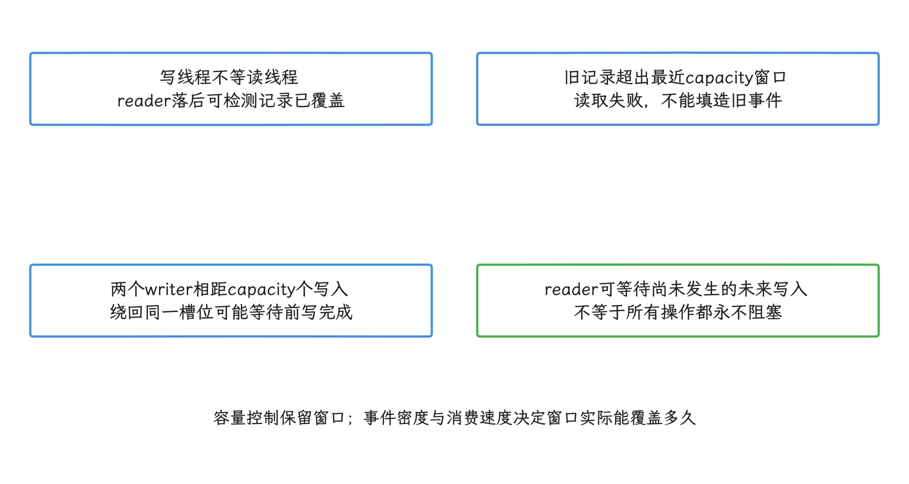

图：图示依据LockFreeRingBuffer源码并发契约；buffer满不自动提供持久化或完整性保证。

```text
业务 trigger / 远程配置
          │
          ▼
    TraceController
          │ 选择 provider
          ▼
 ┌───────────────────────────────┐
 │ 应用进程                      │
 │ ATrace provider ─┐            │
 │ stack provider ──┼─> logger ──┼─> mmap ring buffer
 │ counters ────────┘            │          │
 └───────────────────────────────┘          ▼
                                      TraceWriter
                                           │
                                           ▼
                                      应用私有文件

系统 Perfetto / ftrace 是另一条采集链路。
```

图中的上传、限额、脱敏和服务端分析都要接入方自己实现。Profilo 有个名为 `upload` 的文件目录，它只能说明文件处于待处理阶段，从这里推不出“默认会压缩、加密并上传”。

<!-- gracker-diagram: a299-08-profilo-controller-to-private-files -->
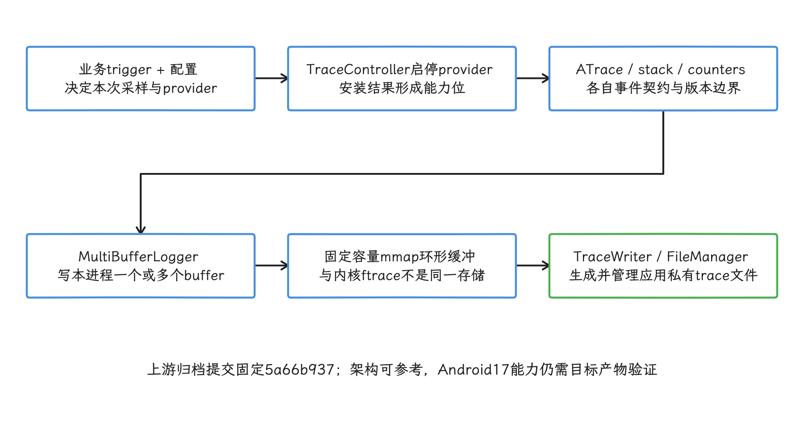

图：加密、上传、后端与保留策略由接入方实现；名为upload的目录不证明已联网上传。

### ATrace 事件的写入路径

ATrace 事件最终写入内核 ftrace 的 `trace_marker`——用户态向 ftrace 提交文本事件的接口文件；这一段的平台源码是 AOSP `android-17.0.0_r1`。初始化代码见 [`libcutils/trace-dev.cpp`](https://android.googlesource.com/platform/system/core/+/refs/tags/android-17.0.0_r1/libcutils/trace-dev.cpp)：它优先打开 `/sys/kernel/tracing/trace_marker`，失败后再尝试 `/sys/kernel/debug/tracing/trace_marker`。

状态定义见 [`trace-dev.inc`](https://android.googlesource.com/platform/system/core/+/refs/tags/android-17.0.0_r1/libcutils/trace-dev.inc)，其中保存 `atrace_marker_fd` 与 `atrace_enabled_tags`，再用 `write()` 写入格式化事件；`fd` 是进程标识已打开文件的整数句柄，`atrace_marker_fd` 存的就是该接口文件的句柄。

用户态格式包含以下前缀：

| 前缀 | 语义 | Profilo 上游 ATrace provider |
|---|---|---|
| `B` / `E` | 当前线程同步 slice 开始 / 结束 | 保存 |
| `S` / `F` | 异步事件开始 / 结束 | 忽略 |
| `G` / `H` | 指定 track 的异步事件开始 / 结束 | 忽略 |
| `I` / `N` | 进程或指定 track 的 instant event | 忽略 |
| `C` | counter | 忽略 |

异步事件用名称和 cookie 配对，可以跨线程结束；track 是时间线中的独立轨道，instant event 只标记一个时刻，counter 记录随时间变化的数值。这里的 cookie 是调用方提供的配对标识，和浏览器 cookie 没有关系。

Java API 见 [`android.os.Trace`](https://android.googlesource.com/platform/frameworks/base/+/refs/tags/android-17.0.0_r1/core/java/android/os/Trace.java)，JNI 是 Java/Kotlin 调用 native C/C++ 实现的桥接接口；android.os.Trace 的 JNI 在 Android 17 进入 native tracing 实现。

[`tracing_perfetto`](https://android.googlesource.com/platform/frameworks/native/+/refs/tags/android-17.0.0_r1/libs/tracing_perfetto/tracing_perfetto.cpp) 按启用状态选择 ATrace 兼容路径或 Perfetto Track Event 路径，Track Event 是 Perfetto 表示 slice、instant 与 counter 等事件的结构化数据模型。`Trace.beginSection()` 仍是公共同步 slice API，必须在同一线程按嵌套顺序调用 `endSection()`；名称上限为 127 个 UTF-16 code unit——code unit 是 Java `String.length()` 使用的计数单位：常见基本平面字符占一个，部分 emoji 等补充字符由代理对表示，会占两个。竖线、换行和空字符会在 trace 中替换为空格。

这段写法适合给名称固定的业务阶段添加公共 trace 标记：

```kotlin
import android.os.Trace

inline fun <T> traceSection(name: String, block: () -> T): T {
    Trace.beginSection(name)
    return try {
        block()
    } finally {
        Trace.endSection()
    }
}

val result = traceSection("Feed.bindVisibleItems") {
    bindVisibleItems()
}
```

<!-- gracker-diagram: a299-10-android17-trace-backend-branches -->
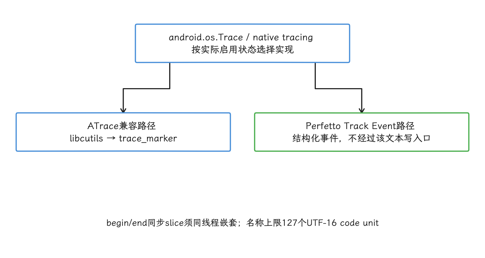

图：Profilo单库PLT hook只观察命中该入口的写入；API存在与目标构建实际被捕获是两个验收项。

`finally` 保证异常路径也能关闭 slice。高基数指可能出现的取值特别多，例如 URL、账号与订单号；把这些值放进 section name 会撑大 trace 体积，还可能暴露敏感信息。线上事件名保持固定，必要参数等采样命中后再交给受控日志。

### Profilo ATrace provider 的精确行为

native 捕获逻辑位于 [`cpp/atrace/Atrace.cpp`](https://github.com/facebookarchive/profilo/blob/main/cpp/atrace/Atrace.cpp)。

Java 生命周期入口见 [`SystraceProvider.java`](https://github.com/facebookarchive/profilo/blob/main/java/main/com/facebook/profilo/provider/atrace/SystraceProvider.java)。

在 API 27 及更高版本，关键步骤如下：

1. 用 `dlsym()` 在已加载模块中按名字查找私有变量 `atrace_enabled_tags` 和 `atrace_marker_fd` 的地址。
2. 在 `libcutils.so` 上安装 `__write_chk` 的 PLT hook。PLT 是动态链接调用表，hook 会把该表中的目标函数入口改到 Profilo 的替代函数。
3. provider 启用时把 `atrace_enabled_tags` 原子交换为 `UINT64_MAX`，并保存原值。tag mask 是以位表示 ATrace 类别开关的掩码，全 1 表示放开所有类别位。
4. 写入目标 fd 且 provider 处于启用状态时，只解析 `B` 与 `E`，把线程 ID、单调时钟时间和名称写入 Profilo logger。单调时钟只向前计时，不随系统日期校准而回拨。
5. provider 停止时卸载 hook，并尝试恢复原 tag mask。

这里还有一项私有 ABI 假设：`trace-dev.inc` 把 `atrace_enabled_tags` 定义为普通 `uint64_t`，Profilo 却把 `dlsym()` 返回的地址转换为 `std::atomic<uint64_t>*` 后执行 `exchange()` 与 `store()`。

私有 ABI 指源码未向应用承诺稳定的二进制布局和调用约定。符号还在源码里，只说明它没被删掉；这种类型与对齐假设在所有构建上都安全，它证明不了。

命中 API 27+ 的 `__write_chk_hook()` 后，hook 直接返回 `count`，原始 `__write_chk()` 不会再被调用；事件转写进 Profilo 缓冲区，内核 ftrace 缓冲区里不会再有这一笔。这段伪代码只保留该控制流：

```c
ssize_t profilo_write_hook(int fd, const void* data, size_t size) {
    if (provider_enabled && fd == observed_atrace_fd && size > 0) {
        if (is_sync_begin_or_end(data, size)) {
            write_to_profilo_buffer(current_tid(), monotonic_time(), data, size);
        }
        return size; // 不再写入 trace_marker
    }
    return previous_write(fd, data, size);
}
```

hook 对 `S/F/G/H/I/N/C` 同样返回成功，对应记录却没有写进 Profilo，丢失从返回值上看不出来。业务若依赖异步事件、counter、instant event 或自定义 track，必须扩展记录格式与解析器，或者明确声明这些事件不受支持。

<!-- gracker-diagram: a299-11-profilo-hook-parse-and-swallow -->
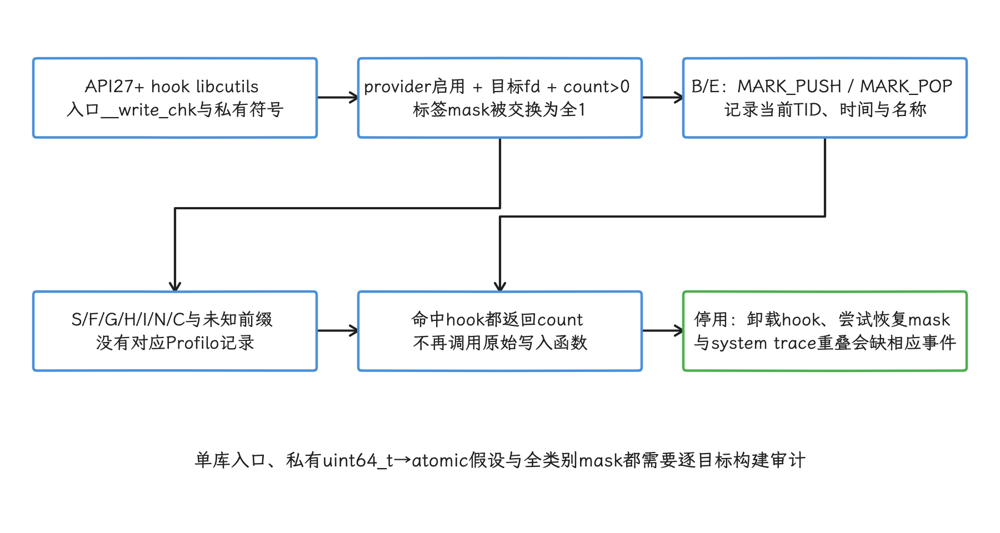

图：中间两类是互斥的解析结果；返回成功不代表已保存不支持的事件。

#### 能看到哪些进程

先回答一个常见疑问：这套 hook 能看到哪些进程？PLT relocation 是动态加载器填入的函数地址槽位，Profilo 修改的是当前应用进程内 `libcutils.so` 的这个槽位；其他进程各有自己的地址空间，不会随之改变。

把 tag mask 设为全 1，放行的也只是当前进程内 framework、ART、HWUI 或 native library 执行到的 ATrace 点；承载系统服务的 `system_server`、负责显示合成的 SurfaceFlinger、窗口管理服务 WindowManager，它一个都触达不了，`sched`、Binder、块 I/O 这些内核 tracepoint 也不会记录。

所以 Profilo ATrace trace 只是一份“当前进程同步 slice 的应用内副本”。systrace 是 Android 早期系统追踪工具和格式的常用称呼；完整的系统时间线还需要跨进程事件与内核调度数据，碰到跨进程因果关系，我们改采 Perfetto system trace。

#### B/E 如何配对

Profilo 在 hook 执行时直接调用 `threadID()`。TID 是内核分配给线程的标识；Profilo 把 `B` 转成 `MARK_PUSH`，把 `E` 转成 `MARK_POP`，并在每条记录中保存 TID。解析器按 TID 分别维护调用栈，无需借助 `sched_switch` 推断事件属于哪个线程：

```text
tid 4101: PUSH Activity.onCreate
tid 4101:   PUSH inflateContent
tid 4101:   POP
tid 4101: POP

tid 4178: PUSH decodeThumbnail
tid 4178: POP
```

每个 TID 的 `PUSH` 与 `POP` 独立配对。缓冲区回绕指写指针走完一圈后复用旧槽位，可能盖掉还没读取的开始事件；采集正好从一段未结束 slice 的中间开始、进程异常退出，或调用方漏掉配对调用，栈同样会不平衡。分析端要把对应区间标成不完整数据，时长一律不补造。

<!-- gracker-diagram: a299-12-thread-lifetime-stack-and-partial -->
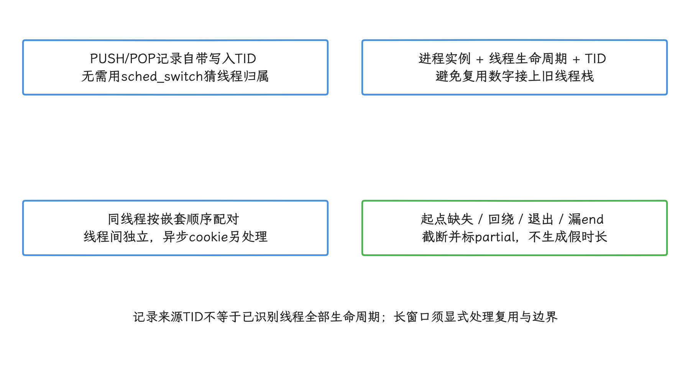

图：采集从slice中间开始也会缺begin；名称、深度与端点完整性分别验证。

### ATrace provider 与 stack provider 的分工

Profilo 的堆栈采样由另一个 provider 完成，native 入口见 [`SamplingProfiler.cpp`](https://github.com/facebookarchive/profilo/blob/main/cpp/profiler/SamplingProfiler.cpp)。

它为目标线程建立 CPU-time 或 wall-time timer：前者只累计线程占用 CPU 的时间，后者按经过的现实时间计时。

timer 到期后发送 profiler signal——由操作系统异步送达的采样信号；信号处理函数接着执行 unwind，从当前寄存器和栈内存中恢复调用帧。

[`TimerManager.cpp`](https://github.com/facebookarchive/profilo/blob/main/cpp/profiler/TimerManager.cpp) 周期性扫描 `/proc` 暴露的线程列表，为新增线程创建 timer，并删除已经退出线程的 timer。

源码中找不到名为“Quicken”的采样模式，也没有通过 PLT hook `pthread_create` 来维护线程清单。

版本上的限制更具体：

- [`CPUProfiler.java`](https://github.com/facebookarchive/profilo/blob/main/java/main/com/facebook/profilo/provider/stacktrace/CPUProfiler.java) 中基于 ART 内部布局的 Java unwinder 版本表只列到 Android 9；
- API 26 及更高版本会把 native tracer 加入候选集合，这只表示代码允许选择该实现；上游二进制在 Android 17 上验证过没有，从这里看不出来；
- signal handler、Java 与 native unwinder，以及其他 SDK 注册的信号处理函数可能互相影响，需要独立压力测试。

ART/DEX/JIT unwind 指跨越 ART 运行时、DEX 字节码和即时编译代码恢复 Java 调用帧。Profilo 的旧 Java unwinder 依赖特定版本的 ART 字段偏移；把 Android 9 的偏移表直接用于 Android 17，可能读到错误地址。

Java 方法采样优先选择 Android Studio CPU Profiler、Simpleperf 或 Perfetto 支持的数据源；API 35 及更高版本还可评估平台的 `ProfilingManager`。

JVMTI 是虚拟机提供的调试与插桩接口，attach 指运行中把 agent 加载进目标进程。Android 的 JVMTI attach 只对可调试应用开放，普通生产构建里当不了默认入口；扫描 ART 私有内存寻找新偏移，同样放不进生产方案。

<!-- gracker-diagram: a299-13-sampling-provider-thread-timers -->
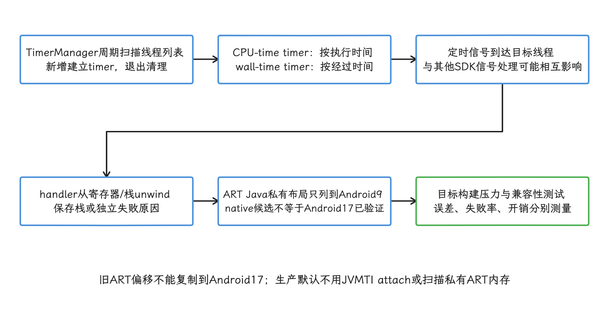

图：源码没有Quicken模式，也未靠pthread_create PLT hook维护线程；不把ATrace B/E当成自动堆栈。

### Android 17 兼容性审计

把前面的线索放到 Android 17 上核对：Profilo 主分支最近一次提交和 release 均为 2023-02-24，早于 Android 17；源码审计只能找出依赖，仍需在目标 APK、系统镜像与设备上验证。

| 能力 | Android 17 源码现状 | 结论 |
|---|---|---|
| `libcutils` ATrace 变量 | `atrace_enabled_tags`、`atrace_marker_fd` 仍存在；前者在平台侧是 `uint64_t` | Profilo 的原子指针转换属于私有 ABI 假设 |
| Java `Trace` | JNI 经 `tracing_perfetto`，`isTagEnabled()` 直接调用 native | Profilo 反射 `nativeGetEnabledTags` 与 `sEnabledTags` 的代码已经过时 |
| PLT hook | 上游 API 27+ 固定 hook `libcutils.so::__write_chk` | 必须用 Android 17 构建产物和目标 OEM 镜像验证 relocation |
| ATrace 事件格式 | Android 17 支持 B/E/S/F/G/H/I/N/C | 上游只保存 B/E |
| Java stack sampling | 上游 ART unwinder 版本表截止 Android 9 | Android 17 不可按上游能力宣称支持 |
| 维护状态 | 官方仓库已归档 | 移植、安全修复和回归由采用方负责 |

这里涉及的限制机制各不相同。hidden API 通常指 Android 对非 SDK Java 接口的访问限制；W^X 要求内存页不同时具备可写和可执行两种属性。

Profilo 的这段 ATrace 代码更直接地依赖 native 私有符号、变量布局和 PLT relocation。

现有证据不足以断言 hidden API、SELinux 与 W^X 在所有 Android 17 设备上都会阻断该流程。

ELF 是 Android native 可执行文件与共享库常用的二进制格式，`.bss` 是其中保存未初始化全局变量的区域。扫描它来猜测私有变量地址可能误识别并修改无关内存，风险很高。hook 失败时应关闭 provider、记录失败阶段，并保持应用主流程可用。

### 继续维护 Profilo fork 时的验证清单

#### 固定源码与构建输入

记录 fork 基于的 `commit`、所有 native 依赖、NDK 版本、ABI、编译器选项和符号文件。`commit` 是 Git 中唯一标识某次源码快照的哈希；NDK 是 Android 的 native 开发工具集；ABI 是应用与 native 库约定的二进制接口，例如 `arm64-v8a`。

AAR 是 Android 库的发布归档。上游 README 明确声明 API 不稳定，直接依赖未固定版本的 AAR，会让 trace schema 与 native 行为难以追溯。trace schema 指每种记录的字段、类型和编码约定；客户端、解析器与服务端必须使用兼容版本。

#### 把 provider 安装结果纳入能力协商

能力协商是客户端在每次采集的同时明确报告“哪些 provider 安装成功、哪些事件类型可用”。`installSystraceHook()` 返回失败时，应跳过 ATrace provider；其他 provider 是否继续由配置决定。

诊断信息至少区分私有符号未找到、PLT hook 安装失败与缓冲区分配失败。后端也要收到对应能力位，避免把内容为空或缺少部分事件的 trace 标成完整数据。

#### 做事件语义测试

我们至少要覆盖以下用例：

- 同线程嵌套 B/E，确认名称、TID、时间顺序和深度；
- 两个线程同时写入，确认各自栈互不干扰；
- async、counter、instant 和 track 事件，明确是补充实现还是声明不支持；
- trace 开始前已有未结束 section、缓冲区回绕、异常退出和 provider 重复启用；
- 启停后 `atrace_enabled_tags` 恢复，并测试与 Perfetto system trace 并发时的事件缺失；
- `android.os.Trace`、NDK ATrace 和直接使用 Perfetto SDK 的事件分别测试——它们未必经过同一个 PLT 入口。

Profilo 启用期间会吞掉命中 hook 的 ATrace 写入，并发的 Perfetto system trace 因此可能缺少本进程的 ATrace 事件。工程上应禁止两类采集重叠，或者把这种缺失写进采集模式和分析协议，避免把两份结果都标成完整。

<!-- gracker-diagram: a299-14-fixed-artifacts-and-hook-capabilities -->
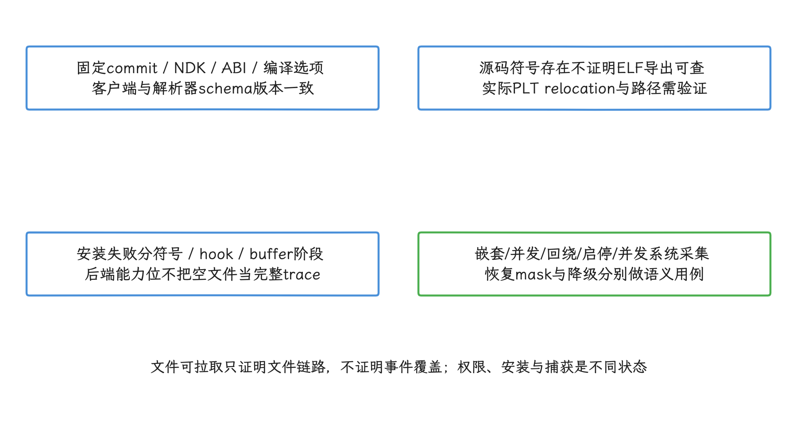

图：扫描.bss猜私有地址会误写内存；不能仅凭hidden API、SELinux或W^X名称断言所有构建必然失败。

#### 用上游工具检查文件

Profilo 官方 [`trace-processing` 文档](https://github.com/facebookarchive/profilo/blob/main/docs/trace-processing.md)提供了从应用私有目录拉取最近 trace 的工具。这组命令只用于开发环境验证文件能否下载和解析，线上上传流程是另一回事：

```shell
cd python
python3 -m profilo.profilo pull_traces \
  --last com.facebook.profilo.sample
python3 -m profilo.workflow_demo --help
```

成功拉取后，还要检查 provider 注解、事件数量、首尾时间、丢失记录和缓冲区覆盖计数。文件存在只证明写文件这一步运行过；hook 捕获完不完整，它说明不了。

#### 建立本项目的开销预算

不要沿用固定的微秒或百分比，至少测量：

- provider 关闭、只开 ATrace、只开 stack、组合开启四组；
- 冷启动、滚动、动画、后台恢复和空闲五类场景；
- CPU time、帧时长、内存分配、RSS、功耗、trace 字节数和缓冲区覆盖次数；
- 低端与高端设备、4 KB 与 16 KB page-size 设备；
- P50/P95/P99 以及未开启采集的对照组。

RSS 是进程当前驻留在物理内存中的页总量。P50、P95、P99 分别表示 50%、95%、99% 样本不超过的分位数，可用来观察典型开销与尾部抖动。page size 是内核管理虚拟内存的基本页大小，4 KB 与 16 KB 设备可能呈现不同的分配和映射成本。

事件密度是开销评估的重要变量，光凭“是否发生系统调用”推算不出结果。Profilo 命中 hook 后省去 `trace_marker` 写入，同时增加事件解析、取时间戳、取 TID 与写 Profilo 缓冲区的成本；差值必须由目标构建实测。

### 新项目的选型路径

#### 只需要公共业务标记

Java/Kotlin 可使用 `android.os.Trace` 或 AndroidX Tracing，native 可使用 NDK ATrace。这些 API 负责发出标记，不会自行启动或保存一份 trace；采集端启用对应类别后，标记才会出现在 Perfetto system trace 中。

截至 2026-08-16，[AndroidX Tracing release notes](https://developer.android.com/jetpack/androidx/releases/tracing)列出的稳定版是 `1.3.0`。它适合通过公共 API 写系统 trace 标记，维护范围比私有变量与 PLT hook 清晰。

#### 需要线上应用内 trace

官方用法见 [AndroidX Tracing 的 in-process tracing](https://developer.android.com/topic/performance/tracing/in-process-tracing)。

`2.0.0-beta01` 提供可插拔 backend 与 sink，并可把应用内事件写成 Perfetto trace packet。trace packet 是 Perfetto 文件中承载事件、时间戳与关联字段的序列化记录单元。

它目前仍是预发布版本。采用方要把 API 变更、依赖升级和回归测试纳入计划。

[Perfetto Tracing SDK 的 in-process backend](https://perfetto.dev/docs/instrumentation/tracing-sdk) 面向 C++17 客户端，也能由应用自行控制采集。

in-process 表示采集服务与应用数据源都运行在同一个应用进程内，不连接系统 `traced`。

trace session 是一次有明确开始、配置、停止和输出结果的采集。backend 决定事件送往进程内服务还是系统 `traced`，sink 则决定数据写到何处。

两种 in-process 方案都只包含应用注册的数据源，不会自动加入调度器、系统调用或其他系统进程。Perfetto 官方也建议：Android 应用若只需简单时间区间和 counter，继续使用 `android.os.Trace` 或 NDK ATrace 即可。

选择应用内采集后，仍需实现抽样、大小与频率限制、脱敏、加密、上传和服务端保留策略。Perfetto 格式解决数据模型与工具兼容问题，不会替应用决定哪些用户、哪些场景允许采集。

#### 需要系统级因果分析

Android 10 及更高版本应优先使用 Perfetto system trace。它能在同一时间轴上组合应用标记、`sched`、Binder、CPU 频率、内存和 I/O 等数据。Perfetto SDK 的 system backend 连接系统 `traced`，读取结果受平台权限控制，主要适合开发机、实验室或受控系统环境。

API 35 及更高版本的 [ProfilingManager](https://developer.android.com/reference/android/os/ProfilingManager) 允许应用请求系统 trace、堆采样等受平台管理的 profile。平台负责调度、频率限制与结果交付，它也不授予应用任意读取持续系统 trace 的能力。

<!-- gracker-diagram: a299-15-stable-tracing-driver-and-system-scopes -->
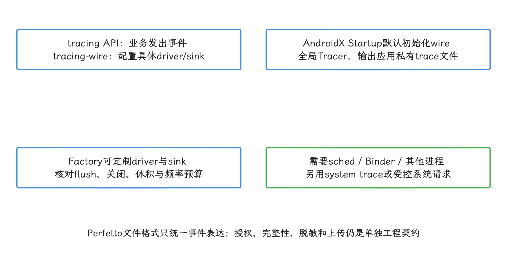

图：截至2026-10-25最新稳定2.0.5；C++17也可用Perfetto SDK in-process，均不自动捕获内核事件。

### 工程决策

| 现状 | 建议 |
|---|---|
| 已有维护多年的 Profilo fork 和配套后端 | 保留架构，按 Android 17 清单重新验证；把 ATrace B/E 子集和失效条件写进协议 |
| 只想复用上游 AAR 快速上线 | 不建议；仓库已归档，Android 17 与 OEM 兼容性没有维护方保证 |
| 新建 Java/Kotlin 应用内 trace | 评估 AndroidX Tracing `2.0.0-beta01`，并接受预发布 API 风险 |
| 新建 native 应用内 trace | 评估 Perfetto SDK in-process backend |
| 线下或实验室定位跨进程问题 | 使用 Perfetto system trace，不用 Profilo trace 代替系统时间线 |
| 只需持续指标与异常触发 | 优先做聚合指标和短窗口触发，命中后再采集受控 trace |

Profilo 的 provider 组织方式、触发控制、固定容量缓冲区与异步文件处理仍可作为架构参考。要继续使用它的源码，就得把 `libcutils` 私有变量、特定 PLT relocation 和旧 ART 布局当作需要逐版本验证的兼容层。

## 全文小结

eBPF 能在具备系统权限的设备上补充系统调用与 Binder 的证据，但完整事件、稳定的方法语义、普通应用权限，这些它都不会自动带来。我们做设计时，应同时核对 AOSP BPF loader、6.18 Binder UAPI / tracepoint、目标系统镜像权限和实际丢失计数；WOOTdroid 的数据，只当 Android 16 研究原型参考。

ATrace 与 Profilo 代表应用进程内的另一条采集路径：前者提供公共事件协议，后者的会话、触发和环形缓冲架构仍可参考，只是上游实现已经归档，并依赖私有符号、PLT hook 和旧 ART 布局。新项目应优先选择公共 ATrace、Perfetto、AndroidX Tracing 或 `ProfilingManager`；继续维护 Profilo fork 的团队，则必须把事件子集、安装失败和缓冲区覆盖写进能力协议。

普通应用的线上诊断以公开 API 和应用自有观测为主；只有 OEM、userdebug 或授权研究环境需要更深的内核证据时，才启用版本绑定的 BPF / Binder 方案，并默认停在元数据层。无论选哪条路径，权限、丢失、采集成本与隐私约束，我们都要分别记录。
