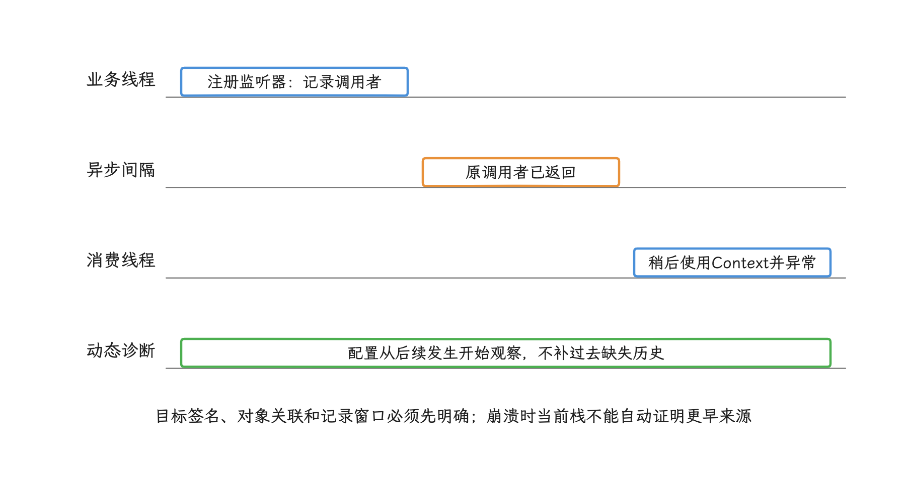
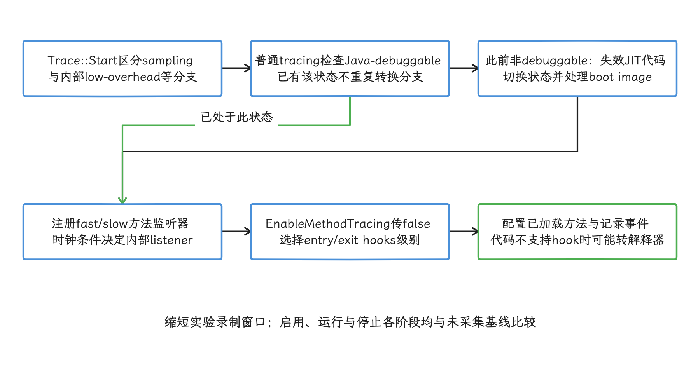
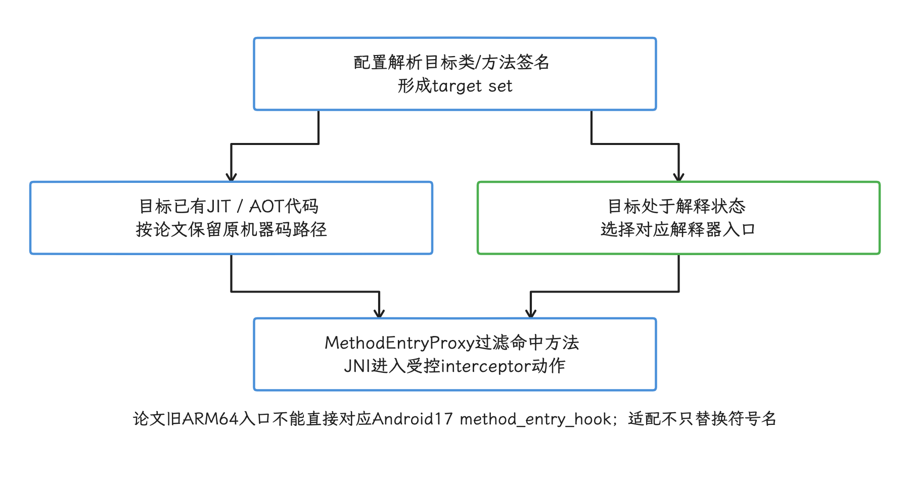
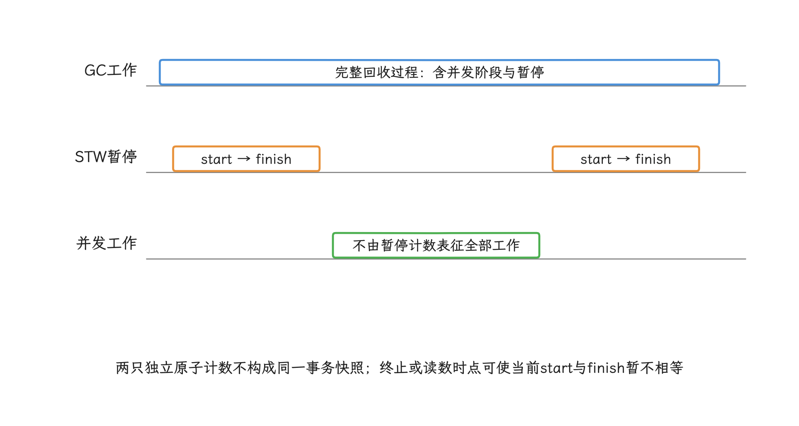

# ART 动态方法追踪与 JVMTI 边界

动态方法追踪会在程序运行时记录指定方法的进入、退出或异常事件。XTrace 论文针对一个生产诊断难题：事故发生后才知道要观察哪个方法，希望无需重新发版就能下发目标，同时避免全量方法追踪拖慢用户设备。

本篇以公开arXiv v1为机制和实验数字基线；ICSE2026官方SEIP议程也已列出该报告。所核论文和会议页面未提供可下载SDK、源码或可复现实验脚本，不能据此独立复现内部实现。要判断这项方案，我们需要分开回答三个问题：

- 论文公开了哪些机制和实验结果；
- 这些机制与 `android-17.0.0_r1` 的 ART 源码是否一致；
- 普通应用可以采用哪些受支持的方案，哪些能力只能由自研基础设施或系统镜像提供。

ART动态方法追踪可通过运行时插桩或JVMTI事件获得方法级信号。XTrace研究生产环境动态选择；普通App的JVMTI运行期attach要求debuggable，profileable不能替代这一授权，事件选择还决定去优化范围。

## 动态选择、插桩与生产开销

### 证据范围

截至2026-10-25，arXiv提交历史仍列2025-12-25的[固定v1手稿](https://arxiv.org/html/2512.21555v1)，其页面仅列arXiv DOI；但[ICSE2026官方议程](https://conf.researchr.org/details/icse-2026/icse-2026-software-engineering-in-practice/74/XTrace-A-Non-Invasive-Dynamic-Tracing-Framework-for-Android-Applications-in-Producti)明确列出2026-04-15的SEIP报告。因此“没有公开会议记录”的原判断应撤回；本篇继续把v1中的机制/数字与会议议程的存在分开引用，不把旧稿模板页眉当作正式出版信息。

论文同样没有附带 XTrace 源码、SDK、符号表或可复现实验脚本。所以我们把文中的结论按三类证据区分：

| 标记 | 含义 |
|---|---|
| 论文报告 | 数字、案例或内部流程来自 arXiv v1，公开资料不足以独立复现 |
| Android 17 源码确认 | 能在 `android-17.0.0_r1` 的 AOSP 文件中找到对应实现 |
| 工程建议 | 根据公开机制和风险边界提出的做法，不归入论文结论或平台保证 |

论文报告的兼容范围是 **Android 5.0–15+**。Android 17 部分来自源码对照，它说明 ART 实现已与论文时代不同；XTrace 在 Android 17 设备或厂商 ROM 上是否可用，仍要等设备验证。


### 为什么会需要“事后指定目标”的方法追踪

论文把一类线上问题称为 Ghost Bug：调用栈里只有 Framework、WebView 或库代码，缺少业务入口。这个词是论文自定义名称，描述的是“故障现场可见，但更早的触发者已经离开当前调用栈”的诊断困境。这里的 Framework 指 Android 系统向应用提供组件、窗口等能力的框架层。

例如，某个监听器较早注册了不合适的 `Context`，稍后由异步消息触发 `Context.getDisplay()` 异常。`Context` 是 Android 组件访问资源和系统服务的环境对象，部分窗口 API 要求它关联正确的 display。崩溃栈里看到的只是使用这个对象的阶段；要追查对象来自哪里，得回到监听器注册方法被调用的那一刻去记录调用者。事故前若没有日志或插桩，这段历史在常规崩溃上报里就是空的。

几类工具回答的问题并不相同：

| 手段 | 擅长的问题 | 主要边界 |
|---|---|---|
| Perfetto system trace | 把调度、频率、Binder IPC、帧和预埋 trace section 放到同一时间线 | 默认不会记录任意 Java 方法的每次进入 |
| 调用栈采样 | 周期性截取线程栈，找 CPU 热点和概率意义上的调用路径 | 短方法可能落在两次采样之间 |
| `Debug.startMethodTracing()` | 一段时间内的 Java/Kotlin 方法进入与退出 | 追踪开销高，Android 文档建议缩短录制时长 |
| 编译期 ASM 插桩 | 用 ASM 字节码库在构建时改写自有代码与 APK 内字节码 | 无法修改设备 boot class path 中的系统框架类；事故前必须已有插桩 |
| JVMTI / ART TI | 通过原生 agent 接收虚拟机事件并执行调试、分析操作 | Android 仅允许向 `debuggable` 应用附加 agent |
| XTrace 论文方案 | 线上按配置选择目标方法，并记录精确调用事件 | 私有实现、未开源，依赖 ART 内部 C++ 设施 |

<!-- gracker-diagram: a300-02-async-producer-consumer-gap -->


图：观察注册/写入/投递时的调用者，关联稍后读取或执行的对象；已经过去且未记录的事件无法追溯生成。

这张表里还有几个名词要交代。Binder IPC 是 Android 的跨进程调用机制，boot class path 是系统启动时提供给应用的核心 Java 类路径。JVMTI（Java Virtual Machine Tool Interface）是虚拟机向调试器和性能分析工具提供事件的 Native 工具接口，ART TI 是 Android 运行时（ART）对这套接口的部分实现；agent 则是加载进目标进程、通过 JVMTI 接口接收回调的 Native 共享库。`debuggable` 表示应用在清单中明确允许调试和插桩，量产发布包通常关闭该标记。

Perfetto 支持动态 trace config（追踪配置），也支持 Java/Kotlin 调用栈采样。XTrace 的差异在于按方法签名拦截一次具体调用，并在事件发生时执行自定义动作。这种拦截通常称为 hook，指截获或替换内部函数的原有执行入口，属于非公开做法。采样、系统 trace 与精确方法事件，我们按诊断问题组合使用。

### Android 17 的 ART Instrumentation 是什么

#### 事件监听器位于 ART 内部

[`runtime/instrumentation.h`](https://android.googlesource.com/platform/art/+/refs/tags/android-17.0.0_r1/runtime/instrumentation.h) 定义了 `InstrumentationListener`。ART 负责执行应用代码，而 Instrumentation 是它内部向调试器和分析工具分发事件的设施，我们先从这里看起。监听器可以接收方法进入、正常退出、异常展开、字段访问和异常等事件。`ArtMethod` 是 ART 在原生层描述一个已加载方法的对象，`MethodEntered` 会收到当前线程和该对象；正常退出回调还可以接收返回值。

下面的源码摘录用于确认两件事——Android 17 仍有三种插桩级别，以及方法进入事件前的快速检查：

```cpp
enum class InstrumentationLevel {
  kInstrumentNothing,
  kInstrumentWithEntryExitHooks,
  kInstrumentWithInterpreter
};

void MethodEnterEvent(Thread* thread, ArtMethod* method) const {
  if (UNLIKELY(HasMethodEntryListeners())) {
    MethodEnterEventImpl(thread, method);
  }
}
```

这个快速分支在没有方法进入监听器时会跳过事件分发；但追踪一旦启用，安装入口/出口 hook、切换 ART 调试状态、遍历已加载类、写入事件并执行监听器这些步骤都会发生。所以“非目标方法零开销”的说法，仍要用完整路径做实验验证。


#### `EXPORT` 与 Android 公共 API 的距离

`Instrumentation::AddListener()`、`EnableMethodTracing()`、`UpdateMethodsCode()` 和 `ArtMethod` 都是 ART 原生代码中的 C++ 接口。源码里的 `EXPORT` 控制符号在原生二进制中的可见性；Android SDK/NDK 是否承诺兼容，要以公开 API 文档和对应头文件为准。

普通应用可以直接调用 [`android.os.Debug.startMethodTracing()`](https://developer.android.com/reference/android/os/Debug) 这类 Java API；`Debug.startMethodTracingDdms()` 带有 `@hide`，`Instrumentation` 与 `ArtMethod` 则属于平台内部实现。ART APEX 是可独立更新 ART 的模块化系统包，ABI（Application Binary Interface）规定机器码调用约定、数据布局和二进制符号等接口细节。动态链接器命名空间限制应用能加载哪些共享库和符号；私有依赖还会受到 APEX 更新、厂商修改、ABI 变化与符号裁剪影响。

#### Android 17 的方法追踪不再必然全量解释执行

旧版本分析常引用下面这个默认值：

`kDeoptimizeForAccurateMethodEntryExitListeners = true`

这个默认参数在 Android 17 源码中仍然存在，但实际行为由调用方传值决定——[`Trace::Start()`](https://android.googlesource.com/platform/art/+/refs/tags/android-17.0.0_r1/runtime/trace.cc) 就显式传入了 `false`，把默认值覆盖掉：

```cpp
runtime->GetInstrumentation()->AddListener(
    the_trace_,
    Instrumentation::kMethodEntered |
        Instrumentation::kMethodExited |
        Instrumentation::kMethodUnwind,
    listener_type);

runtime->GetInstrumentation()->EnableMethodTracing(
    kTracerInstrumentationKey,
    the_trace_,
    /*needs_interpreter=*/false);
```

`EnableMethodTracing()` 因而选择 `kInstrumentWithEntryExitHooks`，跳过了 `kInstrumentWithInterpreter`。普通 method tracing 由此优先使用方法进入/退出 hook，把所有方法统一交给解释器执行的做法留在了过去。

下面只描述普通、非sampling、未走内部low-overhead分支的tracing路径；不把Trace::Start的所有模式混成同一路径。对原本非Java-debuggable进程，启用时会切换运行时状态并执行相应代码失效/boot-image处理；已处于该状态则不重复该条件分支。它还会配置已加载方法与记录事件：

- 若此前非Java-debuggable，切换状态、使JIT code cache失效并反优化boot image（预加载核心类及编译结果的运行时镜像）；
- `ConfigureStubs()` 进入 `UpdateStubs()` 后，通过 `ClassLinker::VisitClasses()` 检查已加载方法；
- 现有代码不支持 entry/exit hook 时，把非 native 方法入口改到解释器桥；解释器桥会从已编译入口转入字节码解释执行；
- 为每次方法进入、退出或异常展开记录事件。

JIT（Just-In-Time）会在应用运行时编译热点方法，AOT（Ahead-Of-Time）则提前生成机器码。上述状态切换和事件写入都会改变执行条件。Android Studio 官方文档仍建议把 Java/Kotlin 精确方法追踪控制在五秒以内，并提醒插桩会改变被测程序的时间表现。

<!-- gracker-diagram: a300-04-ordinary-trace-start-conditional-costs -->


图：不是所有方法统一解释执行，也不是所有Start模式都有相同状态切换；精确事件仍会扰动时序。

#### Android 17 的入口也发生了变化

论文展示的 ARM64 快速入口名为 `art_quick_instrumentation_entry`。`android-17.0.0_r1` 的 [`quick_entrypoints_arm64.S`](https://android.googlesource.com/platform/art/+/refs/tags/android-17.0.0_r1/runtime/arch/arm64/quick_entrypoints_arm64.S) 已找不到这个旧名称，源码包含 `art_quick_method_entry_hook`，并通过 `artMethodEntryHook` 进入 C++。`Trace::Start()` 还会根据时钟源选择 fast 或 slow listener：fast 路径要求 JIT 代码无需为读取线程 CPU 时钟进入内核，32 位 Arm 因时间戳条件固定使用 slow 路径。这是 ART 内部分类，fast 路径同样带着追踪成本。

所以从 Android 15 换到 Android 17，私有符号映射要重新核对：入口协议、寄存器保存、JIT/AOT code header（编译代码头）、线程挂起条件、失败恢复路径和厂商 ART 版本，每个目标版本都要过一遍。

### XTrace 论文提出了什么

#### 目标注入

论文认为传统 method tracing 的主要静态成本来自处理大量已加载方法。XTrace 把配置指定的方法组成 target set（目标集合），只更新这些方法的入口，其余方法继续沿原入口执行。这个设计减少全局遍历和改写，但监听器状态与运行时切换仍可能产生进程级成本。

#### 自适应入口

stub 是负责保存现场、调用追踪逻辑并恢复执行的一小段入口代码。目标方法已有 JIT/AOT 编译代码时，论文选择 ART 的 instrumentation 快速 stub，在回调后继续执行原机器码；方法处于解释状态时，则选择解释器入口。两类入口分开选择，避免把已有编译代码的目标方法统一改走解释器。

#### 事件代理

论文将事件代理注册到方法进入事件，再通过 JNI 调用 Java 层 interceptor。JNI（Java Native Interface）负责 Java/Kotlin 与 Native 代码之间的调用和对象引用；interceptor 是收到命中事件后执行采集动作的拦截器。配置包含类名、方法名、参数/返回类型签名和动作，例如只在 `addWindowLayoutInfoListener()` 被调用时采集调用栈。

这段伪代码只复述论文 Algorithm 1 的职责顺序，离可直接编译还远，线程挂起、JIT 并发和失败恢复也都停在纸面：

```text
将 EnableMethodTracing 的全局处理替换为空处理
对目标方法集合逐个选择入口，并更新方法入口
注册 MethodEntryProxy
借助 Debug.startMethodTracingDdms 启动事件处理
MethodEntryProxy 只处理配置命中的方法
```

所核v1没有公开hook引擎、符号解析、重载消歧、入口同步或卸载代码；会议议程的存在不会补足这些实现输入。直接把伪代码翻成 native hook，会遗漏暂停线程、原子更新入口、处理 JIT 重编译和恢复原入口等进程安全条件。

<!-- gracker-diagram: a300-05-targeted-entry-and-proxy-dispatch -->


图：机制来自论文而非可运行SDK；同步、JIT重编译、挂起、卸载和失败恢复缺公开实现。

#### “不侵入”的适用范围

XTrace 不改写 DEX 方法体（DEX 是 Android 保存字节码、类型和方法索引的文件格式），也不覆盖目标机器码开头；后一种做法通常称为 inline hook。它仍会 hook ART 私有函数、定位 `ArtMethod` 并改变方法执行入口。所以论文里的“Non-Invasive”，说的是相对其他 hook 路径减少了改写范围；公开 Android API、Play Integrity 结果、SELinux 策略和厂商 ROM 兼容性都没有随之获得保证。Play Integrity 用于评估应用和设备环境完整性，SELinux 则执行系统强制访问控制。

论文称其 SDK 无需 root 或系统权限，并把 `UpdateMethodsCode`、`EnableMethodTracing`、`MethodEntered` 称为 “public subset”。这里的 public 指作者选用的 ART 符号子集；按 Android API 的定义，这些 C++ 接口仍是平台内部实现。我们把作者的部署经验与 Android SDK 的兼容性承诺分开记录。


### 论文实验应该怎样读

#### 在线稳定性

DAU（Daily Active Users）是每日活跃用户数。论文报告了一次持续一个月、约 1.08 亿 DAU 的 A/B 实验：用户被分到不启用 XTrace 的对照组和启用 XTrace 的实验组，两组各约 5400 万人。Crash User Rate 和 ANR Rate 是论文沿用的指标名；ANR 表示 Application Not Responding（应用无响应），公开文本没有给出两项指标的去重周期和精确分母。

| 指标 | 对照组 | XTrace 组 | 相对变化 | p 值 | 论文结论 |
|---|---:|---:|---:|---:|---|
| Crash User Rate | 0.018490% | 0.018501% | +0.0595% | 0.615817 | 通过论文设定的 +0.5% 非劣界值 |
| ANR Rate | 0.025480% | 0.025510% | +0.1177% | 0.551651 | 通过论文设定的 +0.8% 非劣界值 |

非劣界值用于约束允许的相对恶化；论文列出Crash +0.5%、ANR +0.8%和相应区间，表内结论为Pass。公开v1没有给出原始事件数、去重/日聚合与区间计算细节，也未说明界值是否预注册，因此这里仅转录作者的检验结论，不声称已重算或独立证明非劣。p 值高于 0.05 只表示本次检验没有观察到统计显著差异；要下“两组完全等价”的结论，还得看区间和界值，单靠 p 值不够。

这些结果支持的只是该应用、该配置和该统计口径；目标方法数量、命中频率、机型分布或采集动作一变，风险就要重新实验。


#### 启动与单次调用

性能实验只使用一台 Android 15 小米设备，以 `Log.e` 为追踪目标，每个数值来自十次测量。表中的“均值 ± 标准差”同时表示平均值和样本波动。论文 Table 2 报告：

| 启动类型 | 无 XTrace | XTrace | Frida |
|---|---:|---:|---:|
| 冷启动 | 450.2 ± 25.1 ms | 456.7 ± 25.9 ms，增加 6.5 ms | 580.5 ± 45.2 ms，增加 130.3 ms |
| 热启动 | 180.5 ± 10.3 ms | 183.9 ± 10.8 ms，增加 3.4 ms | 215.8 ± 18.5 ms，增加 35.3 ms |

Frida 是支持动态插桩和函数拦截的通用工具。论文还报告 XTrace CPU 增量低于 1%，单方法事件低于 0.01 ms；Frida 对照约为 5%–8% 和 0.1–0.2 ms。这些数字来自单设备、单目标；追踪 100 个方法会增加多少毫秒，要在那个规模上重新测。

#### 消融实验

消融实验会逐项移除设计机制，观察性能变化，以判断每个机制的贡献。论文 Table 3 比较了完整方案、关闭目标注入的全局版本和关闭自适应入口的解释器版本：

| 指标 | 完整 XTrace | XTrace-Global | XTrace-Interpreter |
|---|---:|---:|---:|
| 冷启动增量 | 约 6.5 ms | 约 418.0 ms | 约 8.0 ms |
| CPU 增量 | < 1.0% | 约 37.1% | 约 1.5% |
| 单次调用延迟 | < 0.01 ms | 约 0.03 ms | 约 0.13 ms |

这组数据支持两个局部结论：缩小目标集合主要改善启动与全局 CPU 成本，保留编译代码主要改善高频调用的事件成本。不过实验设备运行的是 Android 15，这组数据也就停在 Android 15；Android 17 原生 tracing 是否仍沿用论文描述的旧路径，要另行验证。

#### 兼容性

ROM 在这里指设备厂商交付的 Android 系统构建。论文报告的范围与结果是：

- Android 5.0–15+；
- 1200 个自动化场景；
- 测试 ROM 覆盖该应用 98% 的 DAU；
- 功能通过率 99.9%；
- 新 Android 版本通常需要 1–2 人日适配。

论文未公开 ROM 清单、失败场景、测试代码和 Android 17 数据。而 Android 17 ART 的入口与 tracing 路径已经变了，所以“更新符号表即可适配”的说法目前缺少公开证据支撑。


### 两个案例能说明什么

#### Ghost Bug：找到错误 `Context` 的生产者

论文案例中，异常发生在 `WindowLayoutComponentImpl.onDisplayFeaturesChanged()` 读取监听器关联的 `Context` 时，影响每天超过 4 万名用户。异常栈里只有系统与库代码，而业务侧想知道的是：谁更早调用了 `addWindowLayoutInfoListener()`。

XTrace 配置命中该注册方法并记录调用栈。论文展示的调用路径从 `SparkFragment.onCreateView()` 经混合容器和 `WebView.evaluateJavascript()`，到 Chromium 的 device-posture 逻辑，再进入 `addWindowLayoutInfoListener()`。团队据此修正传入的 `Context`，报告称三小时内完成定位和修复，发布后小时崩溃数降为零。

这个案例通过记录监听器注册时的调用者，补回了异步消费栈中缺失的来源。遇到异步消费、监听器注册、缓存写入和任务投递时，可以优先观察“谁写入或投递”，再观察稍后“谁读取或执行”。

#### UI 卡顿：从 measure 阶段定位到实例

论文先用 Perfetto 看到 `Choreographer.doFrame` 多次超过 16.6 ms，并把热点缩小到 measure 阶段。随后 XTrace 同时观察 `FrameDisplayEventListener.run` 与 `View.measure`，报告同一个 `RelativeLayout` 每帧出现三次 measure 调用，并保留了各次调用的 Java 栈。

团队据此找到 layout constraint（布局约束）冲突，论文称半天内修复；后续 A/B 实验中，处理组 UI 掉帧率下降 25.95%。不过论文没有说明两套数据是否共享时钟、trace ID 或自动关联逻辑；trace ID 是跨数据源标识同一次诊断事件的关联编号。公开证据能支持的过程就到这里：先用 Perfetto 缩小阶段，再用方法事件定位具体实例，可复用的数据自动关联能力尚无实现细节。


### 生产系统的配套与评审

论文把 XTrace 包装成 native library（原生库）和 Java wrapper（对外封装层），并通过内部 A/B 平台下发配置。它报告的运行流程包括：

- 授权工程师提交带版本的配置；
- 数据保护人员审核目标与动作；
- 通常从 0.1% 用户开始金丝雀发布，也就是先让极少量用户接收配置；
- 观察 Crash 与 ANR 等健康指标；
- 异常时停止下发，并让已接收配置失效；
- 稳定后逐步扩大范围。

数据处理也不止“上传方法名”。论文明确提到运行时数据可能包含方法参数：原始数据只在设备内存中处理，先经 DLP（Data Loss Prevention，数据防泄漏）规则去除或遮盖可识别个人的信息，再使用应用层加密和 TLS 1.3 传输；后端使用聚合数据，并设定 14 天保留期。这些控制要由配套系统实现：TLS 1.3 管住传输过程，DLP、访问控制和删除期限各归其位，XTrace 的方法拦截本身带不来这些。

我们若要设计相似设施，至少要评审四组问题。

#### 配置是否能安全命中方法

- 类加载器决定类来自哪个命名空间；方法重载需要用参数和返回类型消歧；桥接方法是编译器为泛型等语义生成的适配方法。配置必须明确这三类匹配规则；
- Kotlin `suspend` 函数会被编译成带 `Continuation` 的状态机方法，混淆映射则负责把线上短名称还原为源码名称；两者都要纳入签名解析；
- 目标方法尚未加载、被 JIT 重编译或入口被其他工具修改时怎样处理；
- ART APEX 版本、ABI、厂商指纹和符号校验失败时是否拒绝启用；
- 每项配置是否有有效期、设备范围、版本范围和远程停用能力。


#### 回调能否在任意线程运行

- interceptor 必须防止递归，也就是采集过程中触发同一目标时直接旁路；记录日志、序列化或上报路径都可能造成再次命中；
- 阻塞 I/O 要避开主线程、Binder 线程、GC 临界区和持锁路径；GC（Garbage Collection，垃圾回收）负责回收不可达对象，临界区则是运行时要求保持特定锁或线程状态的一段代码；
- 事件缓存必须有容量上限和丢弃策略；
- 正常退出、异常展开和配置撤销需按协议恢复入口/监听器；进程被杀时地址空间直接消失，不能依赖执行恢复代码或OnUnload。下次启动从干净状态重新核验，恢复失败的存活进程应关闭后续动态配置。

#### 数据是否超出诊断目的

- 默认只采集方法标识、线程、时间与必要的调用栈；
- 参数、返回值、对象字段和 WebView 内容要单独授权；技术上可读取不构成采集许可；
- 设备端脱敏前的原始数据同样属于敏感数据；
- 服务端需要审计查询、访问控制、删除期限和按实验隔离。

#### 实验结论是否可解释

- 记录目标数量、命中频率、设备分布、ART 版本和配置动作；
- 分别观察启用、运行、撤销三个阶段，避免只测稳定运行阶段；
- 使用同版本对照组，并预先定义 Crash、ANR、启动和 CPU 的判断标准；
- 对出现过符号解析或恢复失败的设备保留失败分类，并把失败样本纳入风险统计。

### 生产环境的方案选择

| 需求 | 建议工具 | 原因 |
|---|---|---|
| 线上 CPU 热点或长调用路径 | `ProfilingManager` stack sampling、Perfetto 或受支持的采样工具 | 采样开销可控，不要求私有 ART hook |
| 线上系统调度、Binder、帧和内存事件 | `ProfilingManager` system trace / Perfetto | Android 15 起可由应用请求；Android 16 起可注册系统触发器，Android 17 又扩展触发类型 |
| 精确观察自有方法 | 编译期 ASM 插桩，并让采集开关可远程控制 | 行为可测试，版本和代码范围由应用掌握 |
| 本地或实验室中的精确方法事件 | Android Studio method tracing、`Debug.startMethodTracing()` | 平台支持，但录制要短 |
| 对调试包做运行时 agent 分析 | JVMTI / ART TI | agent ABI 受 CTS（Compatibility Test Suite，兼容性测试套件）验证，但只允许 `debuggable` 应用 |
| 普通线上应用动态拦截任意 Framework 方法 | 没有等价的公共 Android API | XTrace 属于未开源的私有基础设施 |
| 自有系统镜像或设备产品 | 基于对应 ART tag 开发并纳入系统验证 | 可以使用内部接口，但要由平台团队维护 ABI 与升级 |

[`ProfilingManager`](https://developer.android.com/reference/android/os/ProfilingManager) 从 API 35 提供 system trace、stack sampling、heap profile 和 Java heap dump 请求。heap profile 会在分配发生时采样并保留代码位置，Java heap dump 则保存某一时刻的 Java 对象及引用关系。API 36 加入系统触发 profiling；Android 17 又增加冷启动、OOM、过度 CPU 使用和系统异常等触发类型，不同触发器会返回系统 trace、调用栈样本或堆转储。请求受限流约束，也不保证每次执行；返回结果经过脱敏，只包含请求应用相关信息。

采样适合回答“哪条路径最热”，自有代码插桩适合记录业务状态的写入者，两者都比修改 ART 私有入口更容易验证和维护。只有目标位于设备 Framework、事件短到采样难以命中、并且必须记录每次调用时，XTrace 这类方案才有独特价值。此时工作范围已经属于运行时平台工程，超出常规应用监控 SDK。

#### 自动化复现链路的证据分工

自然语言真机自动化可以帮助复现问题，但它提供的只是操作与观察记录；方法事件仍要从 ART 或 JVMTI 这条线上取。ARTEMIS 材料列出的诊断面包括 `analyze_logs`、录屏、`video_analyzer`、step screenshot、`inspect_trace`，并提到工作流文案中有 `profile performance` 与 metric tables；同一材料明确说明 README 未声明具体 Perfetto 集成，所以拿到这类报告时，要把它与 Perfetto trace、ART method tracing 分开归档。[来源: DeepResearch/2026-09-08-morning-google-ARTEMIS-真机自然语言自动化-研究材料/04-dump-perf-engineer-cross.md]

用自动化控制器驱动 jank、启动或 soak 实验时，实验记录应把外部刺激也写入证据：输入注入路径，人手点击还是自动化点击，连续点击间隔，弹窗 Safety Net/自愈是否改变冷启动或首帧路径，`ARTEMIS_KEEP_DEVICE_AWAKE` 是否保持唤醒，以及 `DeviceExecutionLock` 是否让单设备同一时刻只有一个任务运行。[来源: DeepResearch/2026-09-08-morning-google-ARTEMIS-真机自然语言自动化-研究材料/04-dump-perf-engineer-cross.md] 这些字段回答的是“这次复现如何施加负载”；ART/JVMTI、Perfetto 和编译期插桩回答的是“目标进程和系统当时发生了什么”。材料还提醒，自动化决策时延会叠在 UI 动画与网络上；因此两类证据要用时间戳或步骤编号对齐；对齐之后，外部控制时延归外部账，应用方法耗时与 ART 事件开销各记各的。[来源: DeepResearch/2026-09-08-morning-google-ARTEMIS-真机自然语言自动化-研究材料/04-dump-perf-engineer-cross.md]


## JVMTI 事件、Attach 与去优化边界

生产方案的目标和开销明确之后，我们再来看 JVMTI 这条标准路径：它能验证方法事件、类重定义和线程状态，量产可用性则取决于应用属性和系统授权。

### JVMTI 的使用边界

先交代两个词：Native 代码在这里指通过 C/C++ 二进制接口运行的代码；profiler 则是采样或记录程序行为、帮助定位性能问题的工具。

ART TI 能观察线程、方法、类、对象分配和 GC，也能设置断点、挂起线程、重定义类。

IDE 是 integrated development environment（集成开发环境），SDK 在这里指集成到应用中的开发与采集组件。这套接口可以改变程序执行，所以 Android 给普通应用划了明确的适用范围：

- ART TI 从 Android 8.0 / API 26 开始提供；
- 公共的 `Debug.attachJvmtiAgent()` 从 Android 9 / API 28 开始提供；
- 运行中的 agent 只能附加到 `android:debuggable="true"` 的应用；
- `profileable` 只向受支持的分析工具开放有限能力，JVMTI attach 权限不在其中；
- JVMTI 适合实验室工具、IDE profiler 和专用调试构建，线上发布版监控 SDK 应选择其他公共接口。

本节的源码对照以 `android-17.0.0_r1` 为准。

Android 官方 [ART TI 说明](https://source.android.com/docs/core/runtime/art-ti) 指出，Android 8 及以上版本由 CTS 检查可调试与不可调试应用各自的 attach 权限、已实现的 JVMTI API，以及 agent 二进制接口的稳定性。

ART TI 属于 AOSP（Android Open Source Project，Android 开源项目），设备厂商无需自行重写整套接口。不同 Android 版本仍可能提供不同的 capability——agent 向当前 JVMTI 环境申请的功能位，比如是否允许生成 GC 事件或给对象设置 tag。

### ART TI、JVMTI plugin 与 agent 的关系

`libopenjdkjvmti` 是 ART 按需加载的 plugin（可由宿主动态装入的功能组件）；该组件加载之后，JVMTI 接口才对 agent 可见。

agent 文件是 `.so` 共享库，也就是 Android 上常见的 ELF 动态库格式；ELF（Executable and Linkable Format）规定可执行文件与共享库的二进制布局。

`jvmtiEnv` 是某个 JVMTI 环境的接口指针，agent 通过它发起调用，ART 再通过已登记的 callback（回调函数）通知事件。

宿主一侧的发起者可以是 adb（Android Debug Bridge，用于从开发机向设备发送调试命令）或 Android Studio；下面这张图区分了宿主、plugin 和 agent：

```text
adb / Android Studio / debuggable 应用
                 │ attach 请求
                 ▼
        ActivityManager + ART 权限检查
                 │
                 ▼
应用进程 ┌─────────────────────────────────────┐
         │ ART runtime                         │
         │   └─ libopenjdkjvmti plugin         │
         │          ▲ jvmtiEnv 调用 / 回调      │
         │          │                          │
         │      libsample-agent.so             │
         │          └─ 有界缓冲与工作线程       │
         └─────────────────────────────────────┘
```

agent 与应用处于同一地址空间，共享同一块进程内存；agent 的越界访问、死锁、ABI 不匹配或回调阻塞，都会直接落在目标进程上。

“标准接口”约束的只是 JVMTI 调用语义，agent 自身的 Native 缺陷仍要靠 agent 自己兜住。


### 两种加载时机

#### 独立 ART 进程的启动参数

手动启动 `dalvikvm` 或 `app_process` 时，可以同时指定 `-Xplugin:libopenjdkjvmti.so` 和 `-agentpath`。这条路径主要服务 ART 自测。

Zygote 是预加载常用框架代码、再通过 fork（从现有进程复制出子进程）派生应用进程的系统进程；普通应用都由已经运行的 Zygote 派生，所以 manifest（APK 中声明组件和运行属性的配置文件）里塞不进 `-agentpath` 这样的启动选项。`system_server` 这类承载核心 Android 系统服务的进程，同样在普通应用可用的范围之外。

#### 运行中附加

Android 提供 shell 命令，把 agent 附加到已经运行的 debuggable 进程。命令示例只展示接口形状；agent 文件必须放在目标进程能读取、SELinux 也允许加载的位置——SELinux 是 Android 的强制访问控制机制，会在普通文件权限之外继续检查进程能否访问和加载该文件。

```shell
adb shell cmd activity attach-agent \
  PROCESS_NAME \
  /data/user/0/PACKAGE_NAME/code_cache/libsample-agent.so=AGENT_OPTIONS
```

`PROCESS_NAME` 填目标进程名；等号后的内容会作为 options 传给 agent，options 是 agent 自行约定的配置字符串。

官方建议把 `.so` 放进应用 Native library 目录，或通过 `run-as` 以应用身份复制到应用数据目录。装载靠 `dlopen()`（进程动态装载共享库的系统函数）完成；把库推到任意公共路径，仍可能卡在文件权限或 SELinux 策略上加载失败。

应用也可以在 API 28 及以上版本调用 [`Debug.attachJvmtiAgent()`](https://developer.android.com/reference/android/os/Debug) 附加自身；下面的代码示例给调试构建留了一个显式开关。

```kotlin
import android.os.Debug

fun attachGcCounterAgent() {
    check(BuildConfig.DEBUG)
    Debug.attachJvmtiAgent(
        "libsample-agent.so",
        "mode=gc-counter",
        object {}.javaClass.classLoader
    )
}
```

`classLoader` 决定 Native library 的搜索路径，`options` 由 agent 自行解析。不可调试进程会收到 `SecurityException`，其他附加失败通过 `IOException` 报告。实验记录应保留异常类型，失败的 attach 在记录里也应保持失败状态。

### Agent_OnLoad、Agent_OnAttach 与 Agent_OnUnload

[`runtime/ti/agent.cc`](https://android.googlesource.com/platform/art/+/refs/tags/android-17.0.0_r1/runtime/ti/agent.cc) 会查找三个导出符号——共享库向动态链接器公开、可按名称查找的函数入口。

| 符号 | 调用时机 | 工程含义 |
|---|---|---|
| `Agent_OnLoad` | 独立 ART 运行时通过启动参数加载 agent | 普通应用通常不用这条路径 |
| `Agent_OnAttach` | 运行中的进程接受 attach | Android 应用调试最常见 |
| `Agent_OnUnload` | ART 运行时关闭时清理 agent | 日常运行中没有与 attach 对称的 detach 回调 |

detach 指在进程继续运行时解除 agent；而 JVMTI 没有与 attach 对称的通用卸载接口。

ART 运行时关闭时会调用 `Agent_OnUnload`，这份源码明确不执行 `dlclose()`，因为已有 agent 可能假设库不会在运行中卸载。agent可停用事件、停止工作线程后DisposeEnvironment释放环境；但它不等待已经运行的callback结束，也不自动恢复该环境挂起的线程、Deallocate内存或销毁raw monitor，这些都要自行处理。固定Android17的.so仍留在地址空间；需要无 agent 的干净基线时，重启目标进程即可。


### 最小 agent：只统计 GC 事件

写 agent 时，先查询潜在 capability，再只申请本次实验所需的部分。callback 是 ART 在事件发生时调用的 agent 函数。

C++ 示例保留 `GetEnv → capability → callbacks → enable` 这条最小顺序。回调只增加原子计数，避免在 ART 回调线程里做文件 I/O 或复杂分配。

```cpp
#include <atomic>
#include <cstdint>
#include <mutex>
#include <jni.h>
#include <jvmti.h>

namespace {

// 本示例只为64位原子计数可无锁的目标ABI构建，不回退到隐藏锁。
static_assert(std::atomic<uint64_t>::is_always_lock_free);
std::atomic<uint64_t> g_gc_start_count{0};
std::atomic<uint64_t> g_gc_finish_count{0};
std::mutex g_init_mutex;  // 仅初始化使用，GC回调不取此锁。
jvmtiEnv* g_running_env = nullptr;

void JNICALL OnGcStart(jvmtiEnv*) {
  g_gc_start_count.fetch_add(1, std::memory_order_relaxed);
}

void JNICALL OnGcFinish(jvmtiEnv*) {
  g_gc_finish_count.fetch_add(1, std::memory_order_relaxed);
}

struct PendingEnvironment {
  jvmtiEnv* env;
  bool committed = false;
  ~PendingEnvironment() {
    if (!committed) {
      // DisposeEnvironment同时清理该环境的capability和事件。
      // 正式工具还应记录清理错误；此示例只返回初始化失败。
      env->DisposeEnvironment();
    }
  }
};

jint StartAgent(JavaVM* vm) {
  std::lock_guard<std::mutex> lock(g_init_mutex);
  if (g_running_env != nullptr) return JNI_OK;  // 重复attach不再建环境。

  jvmtiEnv* jvmti = nullptr;
  if (vm->GetEnv(reinterpret_cast<void**>(&jvmti), JVMTI_VERSION_1_0)
          != JNI_OK || jvmti == nullptr) {
    return JNI_ERR;
  }
  PendingEnvironment pending{jvmti};

  jvmtiCapabilities potential{};
  if (jvmti->GetPotentialCapabilities(&potential) != JVMTI_ERROR_NONE ||
      potential.can_generate_garbage_collection_events == 0) {
    return JNI_ERR;
  }
  jvmtiCapabilities requested{};
  requested.can_generate_garbage_collection_events = 1;
  if (jvmti->AddCapabilities(&requested) != JVMTI_ERROR_NONE) {
    return JNI_ERR;
  }
  jvmtiEventCallbacks callbacks{};
  callbacks.GarbageCollectionStart = &OnGcStart;
  callbacks.GarbageCollectionFinish = &OnGcFinish;
  if (jvmti->SetEventCallbacks(&callbacks, sizeof(callbacks))
          != JVMTI_ERROR_NONE) {
    return JNI_ERR;
  }
  if (jvmti->SetEventNotificationMode(JVMTI_ENABLE,
          JVMTI_EVENT_GARBAGE_COLLECTION_START, nullptr) != JVMTI_ERROR_NONE) {
    return JNI_ERR;
  }
  if (jvmti->SetEventNotificationMode(JVMTI_ENABLE,
          JVMTI_EVENT_GARBAGE_COLLECTION_FINISH, nullptr) != JVMTI_ERROR_NONE) {
    return JNI_ERR;  // pending销毁时释放整个未提交环境，包含已启用START。
  }
  g_running_env = jvmti;
  pending.committed = true;
  return JNI_OK;
}

}  // namespace

extern "C" JNIEXPORT jint JNICALL Agent_OnAttach(JavaVM* vm, char*, void*) {
  return StartAgent(vm);
}

extern "C" JNIEXPORT jint JNICALL Agent_OnLoad(JavaVM* vm, char*, void*) {
  return StartAgent(vm);
}
```

示例用C++17为64位原子无锁的目标ABI构建；初始化失败释放未提交环境，初始化互斥与缓存环境避免重复attach再创建。GC回调只接触进程全局原子计数，不使用可能已被释放的env。它仍省略运行期stop/restart、计数导出、options解析和清理错误上报；成功后保留环境至进程结束，不能把它当完整生产agent。`jvmtiError` 是 JVMTI API 返回的错误码，完整的调试工具要逐项检查并记录。


工具还要保存 agent 状态机（对“未初始化、运行、停用、释放”等合法状态及转换条件的明确记录），并保证停用时没有 callback 与销毁操作并发；原子计数则保证多个线程更新同一计数器时不产生数据竞争。

[JVMTI 规范](https://docs.oracle.com/en/java/javase/21/docs/specs/jvmti.html) 规定，`GarbageCollectionStart` 与 `GarbageCollectionFinish` 只报告 stop-the-world GC 暂停。stop-the-world 表示相关应用线程暂时停止修改虚拟机状态；这两项计数统计的是暂停对，并发回收阶段和全部 GC CPU 工作要另外度量。

这两个回调发生时虚拟机仍处于暂停期，大多数 JNI 与 JVMTI 调用都不可用；所以示例只做原子加法，需要解析、分配内存或写文件时，应通知 agent 工作线程稍后处理。

<!-- gracker-diagram: a300-15-gc-pauses-not-whole-cycle -->


图：固定ART通过JvmtiGcPauseListener分发；受限回调避免JNI、分配和阻塞，稍后工作由安全线程处理。

#### 为什么要先查 capability

先查再申请的理由很直接：官方文档说明 ART TI 只实现部分 JVMTI，capability 还可能随 Android 版本变化。`GetPotentialCapabilities()` 返回当前 ART 运行时可申请的功能位，`AddCapabilities()` 再为这个 `jvmtiEnv` 申请所需部分。

HotSpot 是 OpenJDK 在桌面和服务器环境中常用的虚拟机实现，它声明的能力与 ART 要分开看；若把另一个虚拟机或 Android 版本的 capability 写死，初始化失败后就难以区分是平台缺少能力还是 agent 自身出错。

拿到 capability，事件还没有自动开启，完整顺序是：

1. 查询并申请 capability；
2. 用 `SetEventCallbacks()` 登记回调；
3. 用 `SetEventNotificationMode()` 按事件、必要时按线程启用；
4. 运行实验；
5. 先停用事件，再等待 agent 内部工作结束并释放资源。

phase 是 JVMTI 对虚拟机生命周期阶段的划分，例如加载、启动、正常运行和结束阶段。函数与事件各自规定了允许使用的 phase；在错误阶段调用会失败，事件也可能不会发出。

回调通常在触发事件的线程上执行。回调参数中的局部引用/临时指针不能直接排队给异步线程。原始值可按契约复制；需保留Java对象时仅在该回调允许JNI且线程状态合适时建立/释放global reference，GC暂停等受限回调不能套用此法；消费者线程就是从有界缓冲区取出记录、完成解析、符号化或文件写入的 agent 工作线程。

### 启用事件会怎样影响 ART

去优化是让已经编译或优化的代码退出当前执行形态，好让 ART 拿到调试事件所需的可观测语义；影响范围可能是单个方法、指定线程或全部方法与线程，也有的事件根本用不上这一步。

JVMTI 的开销要看启用了哪些事件，一句“一次额外回调”概括不了；反过来说，加载任意 agent 也不会自动让全进程进入永久解释执行。[`openjdkjvmti/events.cc`](https://android.googlesource.com/platform/art/+/refs/tags/android-17.0.0_r1/openjdkjvmti/events.cc) 把事件启用所需的去优化分成 `kNone`、`kLimited`、`kThread` 和 `kFull`：

| 事件 | Android 17 的去优化要求 | 如何理解 |
|---|---|---|
| breakpoint、exception、method entry、method exit | `kLimited` | 不直接请求全量去优化，仍会启用相应 instrumentation |
| exception catch | `kFull` | 请求所有方法和线程进入全量去优化状态 |
| field access/modification、single step、frame pop、force early return 更新 | 指定线程时 `kThread`，未指定线程时 `kFull` | 线程过滤器会改变影响范围 |
| thread/class、compiled method、GC、monitor、object free、VM object alloc 等 | `kNone` | 不因“启用事件”进入上述去优化路径；回调与数据采集仍有成本 |

表中的英文事件名与源码枚举对应，保留原名便于搜索。`kNone` 说的只是启用事件这一步没有进入去优化流程；回调频率、数据复制和 agent 消费照样有开销。

[`deopt_manager.cc`](https://android.googlesource.com/platform/art/+/refs/tags/android-17.0.0_r1/openjdkjvmti/deopt_manager.cc) 对请求计数。启用 `kFull` 或 `kThread` 事件时增加相应请求，停用时移除，多个 agent 或事件可以同时持有请求；全量去优化可以撤销，前提是所有相关请求都被移除。

`kLimited` 同样有成本：breakpoint 是调试器设置的代码暂停位置，ART 要处理目标方法及活动调用栈；method entry/exit 则走 ART Instrumentation 的方法事件路径。

入口替换、解释器 stub 与 JIT 的关系见 [1.5 ART 编译、优化与去优化机制](../../part1-fundamentals/ch01-architecture/05-art-compilation-verification-deoptimization.md)。Instrumentation listener 的回调位置与 XTrace 的选择性入口方案见本文前半篇。


### 类重定义的标准入口与 ART 扩展

ART TI 的类定义输入是只包含一个类定义的 DEX；桌面 JVM 通常接收 class file。

[`ti_redefine.cc`](https://android.googlesource.com/platform/art/+/refs/tags/android-17.0.0_r1/openjdkjvmti/ti_redefine.cc) 为普通 `RedefineClasses()` 和结构性扩展维护了不同模式，后面分两种模式看。

#### 普通 RedefineClasses

标准入口可以替换方法体，改动类 schema 则会被拒绝。schema 在这里指字段、方法签名、修饰符、父类和接口共同构成的类结构；添加或删除方法、增删字段、改变修饰符或继承关系，都会返回相应 JVMTI 错误。

已经在线程栈上执行的旧方法会成为 obsolete method（仅供现有调用继续执行的旧版本），后续调用才使用新定义。frame 是线程栈里一次方法调用的执行记录，内联则是编译器把被调方法代码嵌入调用点的优化。所以“改了一段代码”离“所有线程立刻执行新实现”还有一段距离：活动 frame、内联、JIT 编译代码和类是否可修改，都要逐项检查。

#### 结构性重定义的支持范围

[`ti_extension.cc`](https://android.googlesource.com/platform/art/+/refs/tags/android-17.0.0_r1/openjdkjvmti/ti_extension.cc) 可以通过 `GetExtensionFunctions()` 公布 `com.android.art.class.structurally_redefine_classes`。

该函数只在完整 JVMTI 可用且 JNI ID 使用索引模式时出现，调用前必须枚举并匹配扩展 ID。JNI ID 是 Native 代码引用 Java 字段或方法的标识；索引模式通过间接索引解析目标，避免把可移动的运行时内部指针直接暴露为 ID。

`GetExtensionFunctions()` 用于枚举当前实现提供的非标准扩展；结构性重定义函数是否存在要靠运行时查询，标准 `RedefineClasses()` 的默认语义也不因它改变。

扩展支持的动作限于增量添加方法或字段，删除成员、改父类、改已实现接口都做不了。这份实现会暂停类加载与对象分配、执行 GC、重建受影响的类和实例、更新子类关系，并调用 `InvalidateAllCompiledCode()` 使现有 JIT 编译代码失效。这样的代价适合 IDE 的受控开发操作，线上热修复要走别的路。

Android Studio Apply Changes 具体走普通重定义、结构性扩展还是其他部署机制，取决于修改内容和工具版本，界面提示本身给不出答案。


### 对象 tag 与堆遍历

heap（堆）是 ART 管理 Java/Kotlin 对象的内存区域，堆遍历会访问其中满足条件的对象。tag 是 agent 与某个对象关联的 64 位整数元数据，应用类的字段里找不到它。`SetTag()` / `GetTag()` 依赖 `can_tag_objects`。

[`ti_heap.cc`](https://android.googlesource.com/platform/art/+/refs/tags/android-17.0.0_r1/openjdkjvmti/ti_heap.cc) 为每个 `jvmtiEnv` 维护 object tag table；堆遍历、引用遍历和 `GetObjectsWithTags()` 都从这张表读取。

`ObjectFree` 还需要 `can_generate_object_free_events`，而且只通知带非零 tag 的已回收对象，全部对象的释放情况要另外设计统计。回调只给出已释放对象的 tag，原对象引用此时已经不可用。

`jlong` 是有符号 64 位整数，tag 的业务含义属于 agent 自身协议；设计 tag 时要处理数值复用、溢出、多个 `jvmtiEnv` 之间的隔离和上传隐私。还要记住，对整个堆做遍历或引用追踪本身就可能明显扰动目标进程，这类结果要对照无遍历的基线再下结论。

allocation 指为对象或 Native 缓冲区申请内存。观察 Native 内存分配时，Perfetto 的 Native 堆采样器 [heapprofd](https://perfetto.dev/docs/data-sources/native-heap-profiler) 更贴近问题，它会按采样规则记录分配调用栈。

观察 Java/Kotlin allocation 时，[Android Studio Memory Profiler](https://developer.android.com/studio/profile/record-java-kotlin-allocations) 已提供受支持的调试路径；自定义 agent 更适合去回答标准工具覆盖不到的窄问题。


### attach 边界与发布构建的选择

debuggable 是运行中附加 JVMTI agent 的硬边界。即使应用不通过 Google Play 分发，把 debuggable 构建发给终端用户也会扩大被调试、注入和修改的攻击面。

[profileable manifest 元素](https://developer.android.com/guide/topics/manifest/profileable-element) 的正确形式是 `<profileable android:shell="true" />`。它允许 shell 侧受支持的 profiler 在发布构建上做有限的本地性能采集，仍不会开放 JVMTI attach。

该元素写在 `<application>` 内部；`android:enabled="false"` 会关闭系统服务和 shell 工具的性能采集权限。

profile 指一次性能采样产生的分析文件或采集过程。

线上发布场景应按目标选择公共能力：

| 目标 | 更合适的入口 |
|---|---|
| 业务方法与阶段耗时 | 编译期字节码插桩、`android.os.Trace`、AndroidX Tracing |
| 系统调度、Binder、频率和渲染因果 | Perfetto system trace，受权限与 profileable 约束 |
| Native 分配 | heapprofd / Android Studio Memory Profiler |
| API 35 及以上的应用 profile 请求 | [ProfilingManager](https://developer.android.com/reference/android/os/ProfilingManager)，接受限流和不保证执行的契约 |
| Java 崩溃、ANR、进程退出 | 应用稳定性采集与 `ApplicationExitInfo` |
| ART 私有 hook 实验 | 仅在固定版本和受控设备验证，边界见本文前半篇 |

JVMTI 与 [26.12 编译期字节码插桩与监控自动化](12-bytecode-instrumentation-monitoring-automation.md) 的编译期插桩适用范围不同。编译期插桩能进入发布构建，但只能观察构建时选定的点；JVMTI 能在运行中选择事件和类，却要求 debuggable，并可能改变 ART 执行形态。


### 一次可复现的 JVMTI 实验

build fingerprint（系统构建指纹）和 page size（虚拟内存管理的基本页大小）都可能改变 agent 的兼容性或实验结果。

commit（源码版本标识）、NDK（Native Development Kit，Android 的 C/C++ 工具链）以及构建 ID 和 `.so` 摘要，用于把事件、符号文件与唯一二进制产物对应起来。

所以每次实验，我们都应把这些信息存下来：

- 设备型号、Android build fingerprint、API、ABI 和 page size；
- 应用 versionCode、签名摘要、`debuggable`、`profileable` 与构建 ID；
- agent 源码 commit、NDK、编译器、ABI、符号文件和 `.so` 摘要；
- attach 入口、库路径、options、`Agent_OnAttach` 返回值和每个 `jvmtiError`；
- potential / requested / granted capability，即运行时可申请、agent 请求和最终取得的功能位；
- 启用的事件、线程过滤器、开始与停止时刻；
- 无 agent、已 attach 但未开事件、开启目标事件三组对照；
- wall time、CPU time、帧、内存、GC、JIT 状态和丢弃事件数；wall time指以明确单调时钟测得的实耗时间并注明是否计深睡，非可回拨日历时间戳；CPU time是线程实际占用处理器的累计时间；
- 进程重启后的恢复结果。

实验结论要限定范围：OEM 指设备或系统构建厂商，Android 17 AOSP 源码能解释参考实现机制，目标 OEM 镜像上的可用性仍要用同一个 agent 验证；一次真机成功，证明的也只是该构建加该配置。

遇到 attach 失败，我们按这个顺序排查：debuggable、ABI、库可读性、SELinux、导出符号、capability 和事件 phase。每一步都有公开状态或错误码可记录，排查的优先级高于扫描 ART 私有内存。


## 全文小结

XTrace 的主要贡献是把“只选择少量目标方法”和“尽量保留原编译执行路径”结合到 ART 方法事件机制上。论文的生产案例与大规模 A/B 数据表明，这条技术路线在作者的基础设施中获得了可用结果。

对照 Android 17 源码，我们得到五条使用边界：

- XTrace 依赖 ART 私有 C++ 实现，Android 公共 API 中没有等价入口；
- 论文只报告 Android 5.0–15+，Android 17 兼容性仍待设备验证；
- Android 17 的普通 method tracing 已显式选择 entry/exit hooks，统一强制解释执行不再符合源码；
- 论文展示的 ARM64 instrumentation 入口已经变化，适配工作远多于替换符号名；
- Perfetto、调用栈采样、`ProfilingManager` 和编译期插桩各有可覆盖的生产场景。

按本篇核到的公开输入，XTrace仍是一项无法独立复现内部实现的系统设计研究，已有ICSE2026 SEIP官方议程记录。目标注入、自适应入口和生产控制流程可为诊断设施设计提供参考；源码、设备覆盖和失败恢复验证齐备后，才具备进入线上进程的工程前提。

JVMTI/ART TI 提供标准的运行时实验入口，可以验证方法事件、GC、对象 tag 和类重定义，但 attach 只对 `debuggable` 应用开放，事件启用还可能触发有限、线程级或全量去优化。它适合 IDE、实验室与专用调试构建；XTrace 那种生产能力依旧要靠私有基础设施，线上应用仍应优先选择 `ProfilingManager`、Perfetto、调用栈采样或编译期插桩。


## 参考资料

1. [XTrace: A Non-Invasive Dynamic Tracing Framework for Android Applications in Production](https://arxiv.org/abs/2512.21555)，arXiv:2512.21555v1，2025-12-25。
2. AOSP `android-17.0.0_r1`：[instrumentation.h](https://android.googlesource.com/platform/art/+/refs/tags/android-17.0.0_r1/runtime/instrumentation.h)、[instrumentation.cc](https://android.googlesource.com/platform/art/+/refs/tags/android-17.0.0_r1/runtime/instrumentation.cc)。
3. AOSP `android-17.0.0_r1`：[trace.cc](https://android.googlesource.com/platform/art/+/refs/tags/android-17.0.0_r1/runtime/trace.cc)、[art_method.h](https://android.googlesource.com/platform/art/+/refs/tags/android-17.0.0_r1/runtime/art_method.h)。
4. AOSP `android-17.0.0_r1`：[ARM64 quick entrypoints](https://android.googlesource.com/platform/art/+/refs/tags/android-17.0.0_r1/runtime/arch/arm64/quick_entrypoints_arm64.S)。
5. Android Developers：[Debug API](https://developer.android.com/reference/android/os/Debug)、[录制 Java/Kotlin 方法](https://developer.android.com/studio/profile/record-java-kotlin-methods)。
6. Android Developers：[ProfilingManager](https://developer.android.com/reference/android/os/ProfilingManager)、[调用栈采样](https://developer.android.com/studio/profile/sample-callstack)。
7. Android Developers：[Android 17 新增 ProfilingManager 触发器](https://developer.android.com/about/versions/17/features#profiling-manager)。
8. AOSP 文档：[ART TI](https://source.android.com/docs/core/runtime/art-ti)。
9. Perfetto：[Tracing documentation](https://perfetto.dev/docs/)。
10. [26.12 编译期字节码插桩与监控自动化](12-bytecode-instrumentation-monitoring-automation.md)。
11. DeepResearch：`2026-09-08-morning-google-ARTEMIS-真机自然语言自动化-研究材料/04-dump-perf-engineer-cross.md`。
12. [固定XTrace arXiv v1全文](https://arxiv.org/html/2512.21555v1)；[ICSE2026 SEIP官方议程](https://conf.researchr.org/details/icse-2026/icse-2026-software-engineering-in-practice/74/XTrace-A-Non-Invasive-Dynamic-Tracing-Framework-for-Android-Applications-in-Producti)（2026-04-15报告）。
